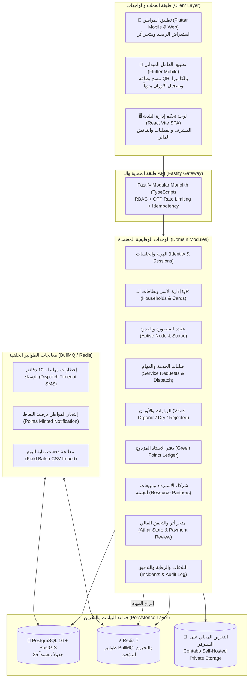
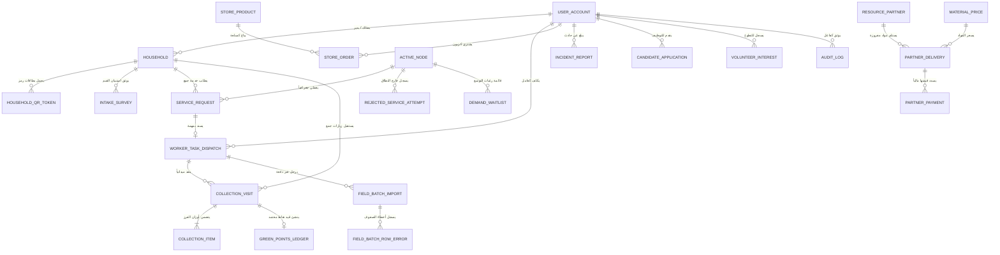
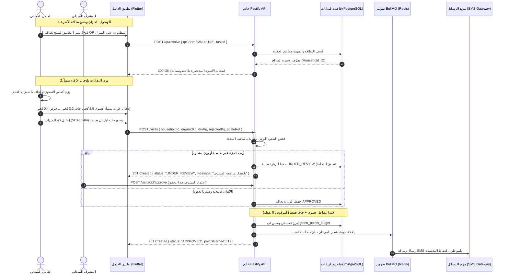
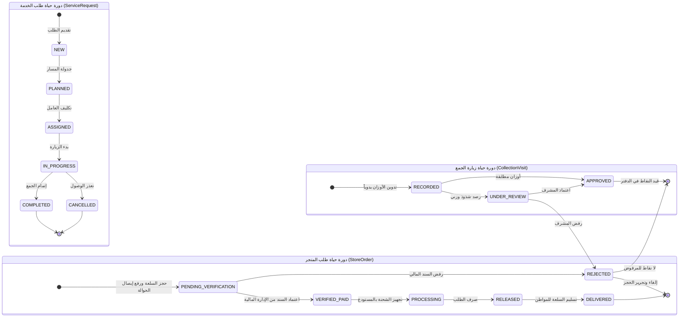
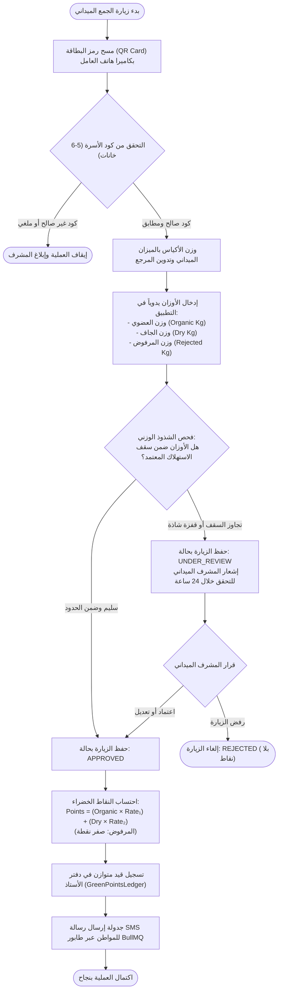

# 🌿 مشروع «أثر» (ATHAR) — منظومة إدارة وفرز النفايات واسترداد الموارد والتحفيز المجتمعي
### ATHAR — Municipal Waste Sorting, Resource Recovery & Civic Incentivization Platform
#### العقدة التشغيلية الأولى: مديرية المنصورة — العاصمة عدن (Node 1: Al-Mansoura, Aden)

---

  <b>منظومة رقمية متكاملة لتحويل فرز النفايات المنزلية إلى حافز اقتصادي وتنموي ملموس عبر بطاقات التعريف المشفرة، الحسابات المزدوجة المتوازنة، ومطابقة النطاقات الجغرافية اللحظية.</b>

---

## 📑 الفهرس العام للمستند (Table of Contents)

1. [نظرة عامة على المشروع (Project Overview)](#-نظرة-عامة-على-المشروع-project-overview)
2. [مخطط معمارية النظام العام (System Architecture)](#-مخطط-معمارية-النظام-العام-system-architecture)
3. [مخطط العلاقات وقاعدة البيانات (Entity Relationship Diagram - ERD)](#-مخطط-العلاقات-وقاعدة-البيانات-entity-relationship-diagram---erd)
4. [مخطط التتابع الزمني للمصادقة والجمع الميداني (Sequence Flow)](#-مخطط-التتابع-الزمني-للمصادقة-والجمع-الميداني-sequence-flow)
5. [مخطط آلة الحالة لدورة حياة الطلب (State Machine Diagram)](#-مخطط-آلة-الحالة-لدورة-حياة-الطلب-state-machine-diagram)
6. [مخطط التدفق لمنطق كشف الشذوذ والأوزان (Business Logic Flowchart)](#-مخطط-التدفق-لمنطق-كشف-الشذوذ-والأوزان-business-logic-flowchart)
7. [دليل التوثيق الهندسي التفصيلي (Detailed Documentation Matrix)](#-دليل-التوثيق-الهندسي-التفصيلي-detailed-documentation-matrix)

---

## 🌍 نظرة عامة على المشروع (Project Overview)

يعالج مشروع **«أثر»** تحديات تكدس النفايات الصلبة وضياع قيمتها الاقتصادية في مديرية المنصورة (عدن)، من خلال حلقة تشغيلية مغلقة تربط بين:
1. **المواطنين (Residents):** فرز النفايات عند المصدر في مسارين (عضوي وجاف)، وإبراز بطاقة الـ QR المطبوعة على المنزل، وكسب «نقاط أثر الخضراء» (Green Points).
2. **عمال النظافة والأسطول الميداني (Field Fleet):** زيارات جمع مجدولة، مسح بطاقة المنزل بكاميرا التطبيق، ووزن الأكياس وتدوين أوزان العضوي والجاف والمرفوض مع كود الميزان يدوياً.
3. **لوحة التحكم المركزية للبلدية (Back-Office Admin Portal):** غرفة قيادة شاملة لإدارة خطط السير، والرقابة على الأوزان والاستثناءات، وإدارة متجر أثر، والتدقيق المالي.
4. **متجر أثر الإلكتروني (Two-Step Digital Store):** شراء المنتجات والسلع الداعمة للبيئة بنقاط أثر والريال اليمني عبر نظام الشراء الرقمي بخطوتين (إرفاق إثبات التحويل المالي والتحقق الإداري المباشر).

---

## 🏛️ مخطط معمارية النظام العام (System Architecture)

يوضح المخطط التالي الترابط بين واجهات المستخدم، بوابات الحماية، خوادم **Fastify** المنظمة كـ **Modular Monolith**، طبقة المعالجة الخلفية، وقواعد البيانات:

> **الأساس المنطقي المعماري:**
> تم اختيار نمط **Modular Monolith** مع Node.js و TypeScript لتفادي التعقيد التشغيلي وشبكات الخدمات المصغرة (Microservices)، مع عزل النطاقات برمجياً. يتم تفريغ العمليات غير المتزامنة (SMS, Push) عبر **BullMQ Background Workers** لضمان استجابة سريعة للـ API بأقل من 50 ميلي ثانية.

---

## 🗄️ مخطط العلاقات وقاعدة البيانات (Entity Relationship Diagram - ERD)

يوضح المخطط الكيانات المحورية المعتمدة في النظام، الروابط بينها، وضوابط القيد المزدوج:

> **الأساس المنطقي لقاعدة البيانات:**
> الاعتماد على نموذج موحد مكون من 25 كياناً معتمداً، مع عزل حسابات النقاط في دفتر أستاذ متوازن غير قابل للتعديل (`Append-Only`) لمنع تضخم النقاط من العدم، وحفظ الحسابات الجغرافية وتطابق العقد ضمن إطار تشغيلي منضبط.

---

## ⏱️ مخطط التتابع الزمني للمصادقة والجمع الميداني (Sequence Flow)

يوثق هذا المخطط التفاعل التبادلي أثناء مسح بطاقة الـ QR، تسجيل الأوزان يدوياً، وصرف النقاط للمواطن:

---

## 🔄 مخطط آلة الحالة لدورات حياة الكيانات (State Machine Diagram)

دورات حياة الكيانات التشغيلية محكومة بآلات حالة محددة تمنع أي انتقال غير مصرح به:

---

## ⚡ مخطط التدفق لمنطق فرز المسارين واعتماد الأوزان (Business Logic Flowchart)

تمثيل خوارزمية فرز المسارين (عضوي وجاف) وفحص الأوزان الميدانية قبل الصرف المالي للنقاط:

---

## 📚 دليل التوثيق الهندسي التفصيلي (Detailed Documentation Matrix)

تم تنظيم التوثيق التقني للمشروع في مسارات متخصصة لتسهيل القراءة والتنفيذ:

| المسار التشعيبي (Document Link) | موضوع الوثيقة | أبرز المحتويات والمخططات |
| :--- | :--- | :--- |
| 📘 [نظرة عامة على المعمارية](docs/01-architecture/system-overview.md) | معمارية النظام ومبادئ التصميم | مخططات C4 (Level 1 & Level 2)، معالجة المهام الخلفية، ومواصفات SLOs. |
| 🖥️ [لوحة تحكم الإدارة المركزية](docs/01-architecture/back-office-portal.md) | المنصة الإدارية للموظفين | مصفوفة RBAC، غرف القيادة الست، والتصميم الهيكلي للواجهة. |
| 🗃️ [مخطط العلاقات والكيانات (ERD)](docs/02-database/erd.md) | بنية قاعدة البيانات الكاملة | تفصيل الجداول وسياقات النطاقات ودورة الشراء بخطوتين وفهارس PostGIS المكانية. |
| 📖 [قاموس بيانات قاعدة البيانات](docs/02-database/data-dictionary.md) | معجم الجداول والحقول | أنواع الحقول، القيود، الشروط، والقيم الافتراضية لكل جدول. |
| ⏱️ [مخططات التتابع الزمني للعمليات](docs/03-flows-and-logic/sequences.md) | تسلسل تدفق البيانات | تسجيل الدخول بالـ OTP، الجمع الميداني، ودورة الشراء الرقمي بخطوتين. |
| 🔄 [آلات الحالة المحددة (FSM)](docs/03-flows-and-logic/state-machines.md) | دورات حياة الكيانات | مصفوفات الانتقال، دورة حياة طلب الخدمة، المهام الميدانية، البلاغات، وطلبات المتجر. |
| 🧠 [منطق الأعمال والخوارزميات](docs/03-flows-and-logic/business-logic.md) | الخوارزميات الحسابية | فحص PostGIS `ST_Covers`، كشف الشذوذ، ومفاتيح منع التكرار. |
| 🔌 [مواصفات وعقود الـ APIs](docs/04-specifications/api-contracts.md) | مواصفات الـ REST Endpoints | عقود الـ Mobile والـ Worker والـ Admin وصيغ أخطاء RFC 7807. |
| 🛡️ [الأمان والامتثال والتحكم بالوصول](docs/04-specifications/security-and-compliance.md) | النموذج الأمني والتشفير | تحليل STRIDE، تشفير AES-256، الفهرسة العمياء، والمصادقة الثنائية. |
| 🗺️ [خارطة طريق المشروع (Roadmap)](docs/04-specifications/roadmap.md) | الجدول الزمني ومراحل الإطلاق | مخطط جانت (Gantt Chart)، معالم المشروع، وخطة تجربة حي ريمي. |
| 🚀 [النشر والعمليات والبنية التحتية](docs/04-specifications/deployment-and-ops.md) | أدلة الـ DevOps والتشغيل | ملف Dockerfile متعدد المراحل، docker-compose، وفحوصات الصحة. |

---

  صُمم وطُوّر بمعايير هندسية عالمية لخدمة البيئة والمجتمع في العاصمة عدن 🇾🇪

