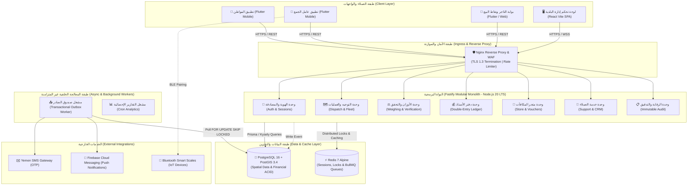
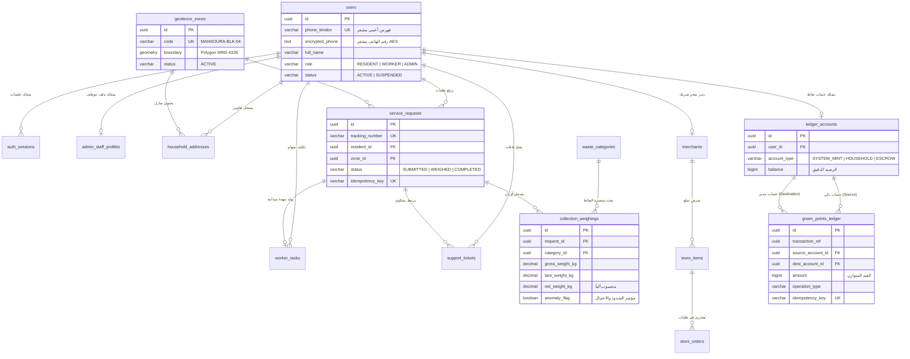
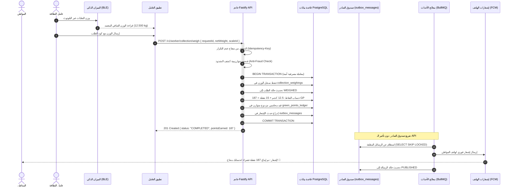
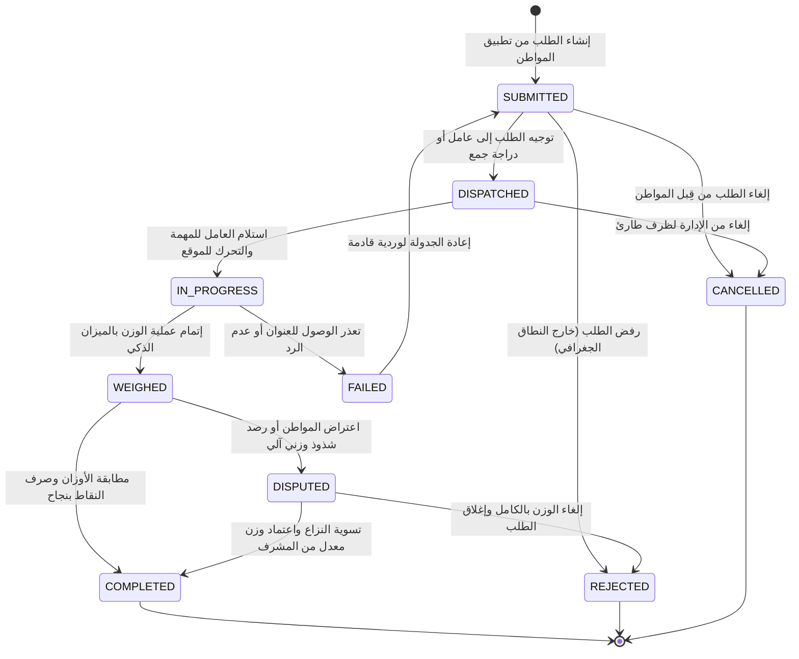
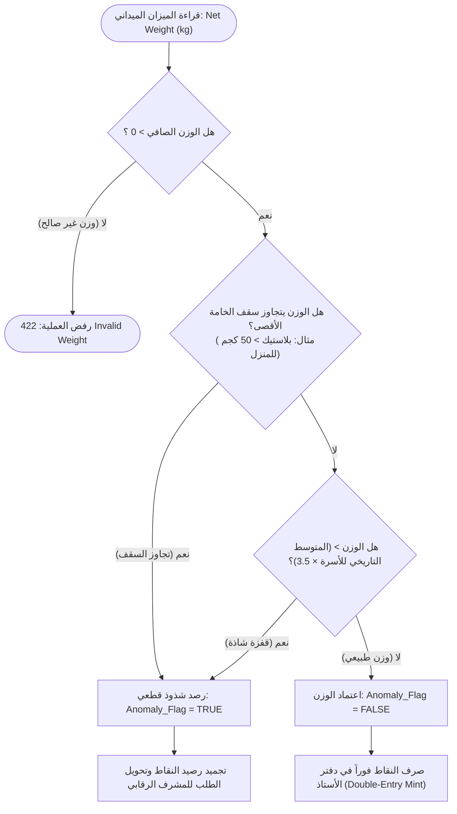

# 🌿 نظام «أثر» للإدارة الذكية للنفايات والتحفيز المجتمعي
### ATHAR — Smart Waste Management & Community Incentivization Platform
#### العقدة التشغيلية الأولى: مديرية المنصورة — العاصمة عدن (Node 1: Al-Mansoura, Aden)

---

<div align="center">

[](https://nodejs.org/)
[](https://www.typescriptlang.org/)
[](https://fastify.dev/)
[](https://postgis.net/)
[](https://redis.io/)
[](https://flutter.dev/)
[](https://react.dev/)
[](https://www.docker.com/)
[](#)

<p align="center">
  <b>منظومة رقمية متكاملة لتحويل فرز النفايات المنزلية إلى حافز اقتصادي وتنموي ملموس عبر إنترنت الأشياء (IoT)، الحسابات المزدوجة المتوازنة، ومطابقة النطاقات الجغرافية اللحظية.</b>
</p>

</div>

---

## 📑 الفهرس العام للمستند (Table of Contents)

1. [نظرة عامة على المشروع (Project Overview)](#-نظرة-عامة-على-المشروع-project-overview)
2. [مخطط معمارية النظام العام (System Architecture)](#-مخطط-معمارية-النظام-العام-system-architecture)
3. [مخطط العلاقات وقاعدة البيانات (Entity Relationship Diagram - ERD)](#-مخطط-العلاقات-وقاعدة-البيانات-entity-relationship-diagram---erd)
4. [مخطط التتابع الزمني للمصادقة والجمع الميداني (Sequence Flow)](#-مخطط-التتابع-الزمني-للمصادقة-والجمع-الميداني-sequence-flow)
5. [مخطط آلة الحالة لدورة حياة الطلب (State Machine Diagram)](#-مخطط-آلة-الحالة-لدورة-حياة-الطلب-state-machine-diagram)
6. [مخطط التدفق لمنطق كشف الشذوذ والأوزان (Business Logic Flowchart)](#-مخطط-التدفق-لمنطق-كشف-الشذوذ-والأوزان-business-logic-flowchart)
7. [دليل التوثيق الهندسي التفصيلي (Detailed Documentation Matrix)](#-دليل-التوثيق-الهندسي-التفصيلي-detailed-documentation-matrix)
8. [دليل التشغيل السريع للمطورين (Quick Start Guide)](#-دليل-التشغيل-السريع-للمطورين-quick-start-guide)

---

## 🌍 نظرة عامة على المشروع (Project Overview)

يعالج مشروع **«أثر»** تحديات تكدس النفايات الصلبة وضعف فرزها من المصدر في مديرية المنصورة (عدن)، من خلال حلقة مغلقة تربط بين:
1. **المواطنين (Residents):** فرز النفايات من المنازل وطلب الاستلام عبر تطبيق الجوال وكسب «نقاط أثر الخضراء» (Green Points).
2. **عمال النظافة والأسطول الميداني (Field Fleet):** جمع وفرز الشحنات ووزنها ميدانياً بدقة فائقة باستخدام موازين ذكية مقترنة عبر الـ Bluetooth.
3. **لوحة التحكم المركزية للبلدية (Back-Office Admin Portal):** غرفة قيادة شاملة لإدارة التوجيه الآلي، وتتبع الأسطول جغرافياً، والرقابة على الأوزان، وإدارة الشكاوى، والتدقيق المالي.
4. **الشركاء والمتاجر المحلية (Merchant Network):** استبدال النقاط المكتسبة بسلع استهلاكية وخصومات حقيقية عبر قسائم رقمية مشفرة (QR Codes).

---

## 🏛️ مخطط معمارية النظام العام (System Architecture)

يوضح المخطط التالي الترابط بين واجهات المستخدم، بوابات الحماية، خوادم **Fastify** المنظمة كـ **Modular Monolith**، طبقة المعالجة الخلفية، وقواعد البيانات:



> **الأساس المنطقي المعماري:**
> تم اختيار نمط **Modular Monolith** مع Node.js و TypeScript لتفادي التعقيد التشغيلي وشبكات الخدمات المصغرة (Microservices) في المرحلة الأولى، مع عزل النطاقات برمجياً. يتم تفريغ العمليات الطويلة (SMS, Push) عبر **Transactional Outbox Pattern** لضمان استجابة سريعة للـ API بأقل من 50 ميلي ثانية.

---

## 🗄️ مخطط العلاقات وقاعدة البيانات (Entity Relationship Diagram - ERD)

يوضح المخطط الكيانات المحورية، المفاتيح الأساسية والأجنبية، وضوابط القيد المزدوج:



> **الأساس المنطقي لقاعدة البيانات:**
> الاعتماد الكامل على `UUIDv7` للترتيب الزمني وتفادي تجزئة الفهارس، مع تطبيق امتداد `PostGIS` لفهرسة النطاقات الجغرافية مكانياً عبر مؤشرات `GiST`، وفصل حسابات النقاط في دفتر أستاذ متوازن غير قابل للتعديل (`Append-Only`).

---

## ⏱️ مخطط التتابع الزمني للمصادقة والجمع الميداني (Sequence Flow)

يوثق هذا المخطط التفاعل التبادلي أثناء تسجيل الوزن الميداني وصرف النقاط للمواطن:



---

## 🔄 مخطط آلة الحالة لدورة حياة الطلب (State Machine Diagram)

دورة حياة طلب الخدمة المنزلي (`service_requests`) محكومة بآلة حالة محددة تمنع أي انتقال غير مصرح به:



---

## ⚡ مخطط التدفق لمنطق كشف الشذوذ والأوزان (Business Logic Flowchart)

تمثيل خوارزمية مكافحة الاحتيال وفحص الأوزان الميدانية قبل الصرف المالي للنقاط:



---

## 📚 دليل التوثيق الهندسي التفصيلي (Detailed Documentation Matrix)

تم تنظيم التوثيق التقني للمشروع في مسارات متخصصة لتسهيل القراءة والتنفيذ:

| المسار التشعيبي (Document Link) | موضوع الوثيقة | أبرز المحتويات والمخططات |
| :--- | :--- | :--- |
| 📘 [نظرة عامة على المعمارية](docs/01-architecture/system-overview.md) | معمارية النظام ومبادئ التصميم | مخططات C4 (Level 1 & Level 2)، نمط Outbox، ومواصفات SLOs. |
| 🖥️ [لوحة تحكم الإدارة المركزية](docs/01-architecture/back-office-portal.md) | المنصة الإدارية للموظفين | مصفوفة RBAC، غرف القيادة الست، والتصميم الهيكلي للواجهة. |
| 🗃️ [مخطط العلاقات والكيانات (ERD)](docs/02-database/erd.md) | بنية قاعدة البيانات الكاملة | تفصيل الـ 28 جدولاً، سياقات النطاقات، وفهارس PostGIS المكانية. |
| 📖 [قاموس بيانات قاعدة البيانات](docs/02-database/data-dictionary.md) | معجم الجداول والحقول | أنواع الحقول، القيود، الشروط، والقيم الافتراضية لكل جدول. |
| ⏱️ [مخططات التتابع الزمني للعمليات](docs/03-flows-and-logic/sequences.md) | تسلسل تدفق البيانات | تسجيل الدخول بالـ OTP، الجمع الميداني، ودورة حياة القسائم. |
| 🔄 [آلات الحالة المحددة (FSM)](docs/03-flows-and-logic/state-machines.md) | دورات حياة الكيانات | مصفوفات الانتقال، حالات طلبات الخدمة، المهام، والتذاكر. |
| 🧠 [منطق الأعمال والخوارزميات](docs/03-flows-and-logic/business-logic.md) | الخوارزميات الحسابية | فحص PostGIS `ST_Covers`، كشف الشذوذ، ومفاتيح منع التكرار. |
| 🔌 [مواصفات وعقود الـ APIs](docs/04-specifications/api-contracts.md) | مواصفات الـ REST Endpoints | عقود الـ Mobile والـ Worker والـ Admin وصيغ أخطاء RFC 7807. |
| 🛡️ [الأمان والامتثال والتحكم بالوصول](docs/04-specifications/security-and-compliance.md) | النموذج الأمني والتشفير | تحليل STRIDE، تشفير AES-256، الفهرسة العمياء، والمصادقة الثنائية. |
| 🗺️ [خارطة طريق المشروع (Roadmap)](docs/04-specifications/roadmap.md) | الجدول الزمني ومراحل الإطلاق | مخطط جانت (Gantt Chart)، معالم المشروع، وخطة تجربة حي ريمي. |
| 🚀 [النشر والعمليات والبنية التحتية](docs/04-specifications/deployment-and-ops.md) | أدلة الـ DevOps والتشغيل | ملف Dockerfile متعدد المراحل، docker-compose، وفحوصات الصحة. |

---

## 🚀 دليل التشغيل السريع للمطورين (Quick Start Guide)

### 1. المتطلبات المسبقة (Prerequisites)
* **Node.js:** الإصدار `v20.x LTS` أو أحدث.
* **مدير الحزم:** `pnpm` (الإصدار `9.x`).
* **Docker & Docker Compose:** لتشغيل قواعد البيانات والخدمات المساعدة محلياً.

### 2. استنساخ المستودع وتهيئة المتغيرات
```bash
# 1. استنساخ المستودع
git clone https://github.com/your-org/athar-platform.git
cd athar-platform

# 2. إنشاء ملف متغيرات البيئة
cp .env.example .env
```

### 3. تشغيل الخدمات الأساسية عبر Docker
```bash
# تشغيل PostgreSQL (مع PostGIS) وخادم Redis
docker compose up -d postgres redis

# التحقق من صحة عمل الحاويات
docker compose ps
```

### 4. تثبيت الحزم وتطبيق الترحيلات (Migrations & Seed)
```bash
# تثبيت الاعتماديات
pnpm install

# توليد عميل Prisma أو تشغيل ترحيلات SQL
pnpm db:migrate

# تغذية قاعدة البيانات بالبيانات الافتراضية (نطاقات المنصورة وخامات النفايات)
pnpm db:seed
```

### 5. تشغيل خادم التطوير ومشغل الصادر
```bash
# تشغيل خادم Fastify في وضع التطوير المباشر
pnpm dev

# في نافذة طرفية ثانية: تشغيل مشغل صندوق الصادر
pnpm worker:outbox
```

### 6. التحقق من سلامة النظام (Health Check)
```bash
curl http://localhost:3000/health/ready
# الاستجابة المتوقعة: {"status":"UP","checks":{"database":"UP","redis":"UP"}}
```

---

<div align="center">
  <sub>صُمم وطُوّر بمعايير هندسية عالمية لخدمة البيئة والمجتمع في العاصمة عدن 🇾🇪</sub>
</div>
