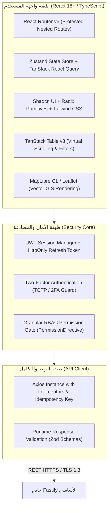
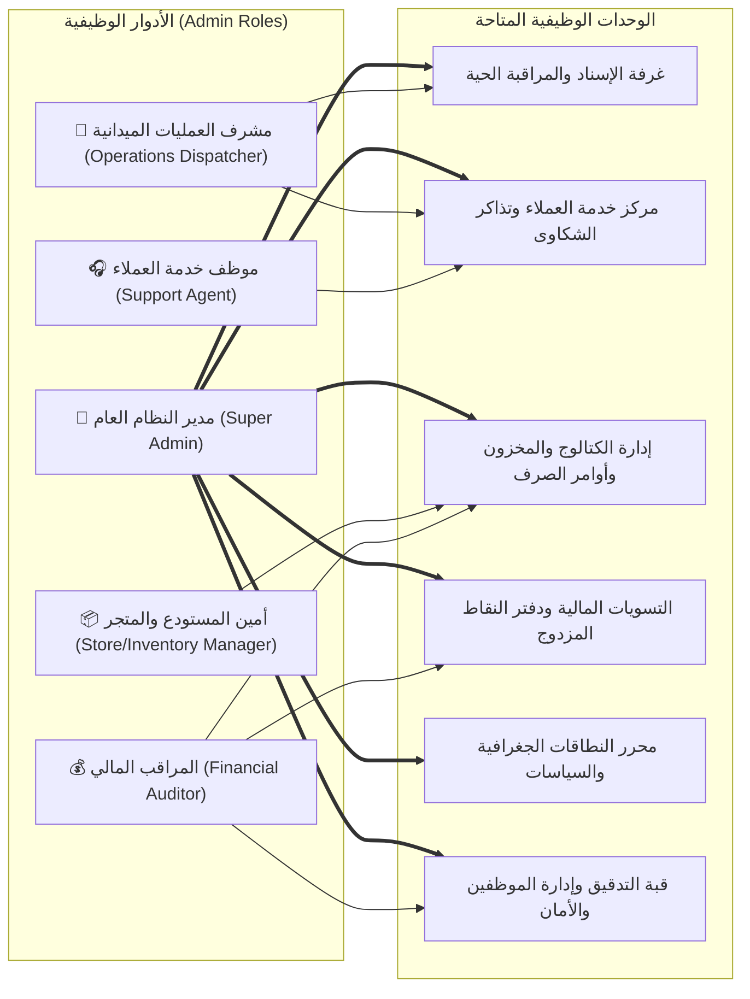

# 💻 بوابة الإدارة والعمليات المركزية (Back-Office Web Portal Architecture)

دليل التوصيف المعماري والتصميمي المفصل لبوابة الويب المخصصة لموظفي الإدارة، المشرفين، خدمة العملاء، ومسؤولي المستودعات والمالية لمنظومة «أثر».

---

## 1. الهوية المعمارية والتقنية للبوابة

بوابة الإدارة والعمليات المركزية هي منصة سطح مكتب تفاعلية متقدمة (**Enterprise Desktop Web SPA**) صُممت خصيصاً لتكون **لوحة التحكم المركزية (Control Plane)** لكافة العمليات الميدانية والتجارية في مديرية المنصورة.

### المواصفات التقنية للبوابة:
* **بيئة البناء والتطوير:** **Vite** مع **TypeScript** لأقصى سرعة بناء وتحديث حي (`HMR`).
* **مكتبة الواجهات:** **React 18+** مع نظام تصميم موحد قائم على **Tailwind CSS** ومكونات **Shadcn UI**.
* **إدارة الحالة والبيانات:** **TanStack React Query** لجلب البيانات المؤقتة (`Server State Caching`) ومزامنتها تلقائياً، مع **Zustand** لإدارة الحالة المحلية للمستخدم والجلسة.
* **عرض البيانات الضخمة والخرائط:** **TanStack Table** لدعم التصفح الافتراضي لآلاف السجلات (`Virtualization`)، ومكتبة **MapLibre GL** لرسم الخرائط المتجهية والطبقات الجغرافية التفاعلية.

---

## 2. مصفوفة الصلاحيات والأدوار الإدارية (RBAC Matrix)

تعتمد البوابة نظام وصول صارم قائم على مبدأ الحد الأدنى من الصلاحيات (`Least Privilege Principle`)، مع إلزامية تفعيل المصادقة الثنائية (**2FA/TOTP**) لكافة مستخدمي البوابة:

---

## 3. تفصيل الوحدات التشغيلية الست (Core Operational Cockpits)

### 1. غرفة المراقبة الميدانية والإسناد الحي (Live GIS Dispatch Cockpit)
* **عرض الخريطة الحية:** خريطة رقمية تفاعلية لمديرية المنصورة توضح:
  - حدود النطاقات الجغرافية المفعلة (`Geofence Polygons`).
  - مواقع وأحياء التغطية (القاهرة، كابوتا، ريمي، عبدالعزيز، وديع حداد).
  - تمركز وخط سير عمال النظافة المسجلين على مهام نشطة.
  - نقاط الجمع الميدانية والطلبات المعلقة التي تنتظر الإسناد.
* **مراقبة مهلة الاستجابة اللحظية (10-Minute SLA Tracker):**
  - عداد تنازلي لكل مهمة مسندة لعامل ميداني.
  - تحول لون المهمة إلى البرتقالي عند مرور 5 دقائق، ثم إلى الأحمر وإطلاق تنبيه صوتي ومرئي عند تجاوز 10 دقائق دون إقرار.
* **التدخل الإداري وإعادة الإسناد (Dispatch Override):**
  - إمكانية قيام المشرف بسحب المهمة من عامل متعثر وتحويلها لعامل ميداني آخر بنقرة واحدة.
  - إلزام المشرف باختيار سبب التدخل (عطل دراجة، انقطاع هاتف، ظرف طارئ)، ويتم تدوين الإجراء تلقائياً في سجل التدقيق المؤسسي.

---

### 2. مركز خدمة العملاء وإدارة الشكاوى (Customer Service & CRM)
* **ملف المستفيد الشامل (Citizen 360 View):**
  - شاشة بحث موحدة برقم الهاتف أو الرمز المحاسبي القصير (`entity_code`).
  - تفاصيل الأسرة: العنوان، الإحداثيات، نوع المنشأة، تاريخ الانضمام.
  - السجل التاريخي للأوزان المجمعة ومسارات الفرز (عضوي vs جاف).
  - رصيد النقاط الحالي وسجل العمليات المدينة والدائنة.
* **إدارة دورة حياة التذاكر (SupportTicket Lifecycle):**
  - تسجيل تذاكر الشكاوى: عدم مرور العامل في الموعد، اعتراض على وزن مسجل، طلب مساعدة لكبار السن.
  - تصنيف الأولوية (`Low`, `Normal`, `Urgent`) وإسناد التذكرة لموظف دعم محدد.
  - إغلاق التذكرة مع تدوين محضر الحل، وإشعار المواطن تلقائياً عبر رسالة SMS بنتيجة المعالجة.
* **إدارة بطاقات QR المفقودة (Card Revocation & Replacement):**
  - إبطال البطاقة المفقودة فورياً من اللوحة (`Revoke Token`).
  - إصدار بطاقة جديدة برمز بصري مشفر جديد (`Cryptographic Card Token`)، مع بقاء الرمز الحسابي للأسرة وسجلاتها التاريخية ثابتاً دون أي انقطاع.

---

### 3. إدارة المتجر والمخزون والتوريد (Store & Inventory Management)
* **إدارة كتالوج المنتجات والأسعار:**
  - إضافة وتعديل السلع المدعومة المتاحة للاستبدال بالنقاط.
  - تحديد السعر بالنقاط، وأي مبالغ نقدية إضافية (الدفع المختلط)، ووضع حد أقصى للشراء لكل أسرة شهرياً.
* **الرقابة الذرية على المخزون (Real-Time Stock Control):**
  - تتبع مستويات المخزون في المستودع الرئيسي ونقاط الصرف الشريكة في المنصورة.
  - مراقبة الحجوزات المؤقتة (`Atomic Stock Reservations`) الصادرة عن سلات المتجر الإلكتروني.
  - إطلاق تنبيهات عند اقتراب نفاد المخزون (`Low Stock Alerts`).
* **اعتماد إيصالات الدفع وأوامر الصرف (Order Verification & Release):**
  - فحص صور إيصالات التحويل البنكي أو المحافظ الإلكترونية المرفقة من المواطنين.
  - مطابقة الرقم المرجعي للعملية والمبلغ المالي الصافي.
  - اعتماد الطلب وتوليد **أمر الصرف الرسمي المعتمد (Release Order)** متضمناً باركود التسليم ومحضر استلام السلعة لنقطة التوزيع.

---

### 4. الإدارة المالية وتسويات الشركاء ودفتر النقاط (Finance & Ledger Audit)
* **تدقيق دفتر الأستاذ المزدوج للنقاط (Double-Entry Ledger Audit):**
  - فحص ميزان المراجعة للنقاط: التحقق اللحظي من تطابق مجموع الحسابات المدينة والدائنة ($\sum Debits = \sum Credits$).
  - كشف ومراجعة أي عمليات استثنائية أو قيود عكسية لتصحيح الأوزان.
* **تسويات قنوات التحصيل والدفع المالي (Payment Gateway & Collections Audit):**
  - مطابقة إجمالي المبالغ المحصلة عبر الحسابات البنكية والمحافظ الإلكترونية مع قيمة طلبات المتجر المؤكدة.
  - كشوفات مطابقة أرصدة التحصيل النقدي والتحويلات البنكية مع مبيعات المنتجات المعتمدة.
* **مراجعة دفعات نهاية الوردية (EOD Batch Import Review):**
  - مراجعة الحزم المرفوعة من العمال الذين عملوا دون اتصال بالإنترنت.
  - استعراض الأخطاء الميدانية المعزولة في جدول `field_batch_row_errors`، واعتماد إدخال الصفوف السليمة دفعة واحدة.

---

### 5. محرر النطاقات الجغرافية والسياسات (GIS & Policy Management)
* **محرر الخرائط الجغرافية (Geofence Boundary Editor):**
  - أداة بصرية لرسم وتحرير المضلعات الجغرافية (`Polygons`) لمديرية المنصورة والأحياء المستهدفة.
  - نظام إصدارات النطاقات الجغرافية (`Versioned Geofences`): كل تعديل في الحدود يُنشئ نسخة جديدة مؤرخة دون المساس بالطلبات أو الزيارات السابقة.
* **تحليل قائمة الانتظار للمناطق غير المخدومة (Demand Waitlist Analytics):**
  - خريطة حرارية (`Heatmap`) للطلبات المرفوضة خارج النطاق (`RejectedServiceAttempt`).
  - تحديد الأحياء المجاورة ذات الكثافة العالية في الطلب لدعم قرارات التوسع الميداني للبلدية وإدارة المشروع.
* **محرك سياسات تحويل الأوزان للنقاط:**
  - ضبط معاملات تحويل الكيلوجرام إلى نقاط حسب طبيعة المادة (عضوي vs جاف).
  - تطبيق مضاعفات الحوافز الترويجية لفترات محددة أو لأحياء معينة لرفع معدلات المشاركة المجتمعية.

---

### 6. قبة الرقابة والتدقيق والأمان (Security & Audit Cockpit)
* **سجل التدقيق المؤسسي غير القابل للتعديل (Immutable Audit Log):**
  - تسجيل دقيق لكل حدث تشغيلي وإداري: هوية الموظف، عنوان IP، البصمة الزمنية، نوع الإجراء، والبيانات قبل وبعد التعديل.
  - واجهة بحث وفلترة متقدمة لتسهيل أعمال التفتيش والرقابة الداخلية.
* **إدارة الحسابات والجلسات النشطة (Session & Access Control):**
  - إنشاء وتعديل حسابات الموظفين وربطها بالأدوار الدقيقة.
  - استعراض الجلسات النشطة لحظياً، مع إمكانية إنهاء جلسة أي موظف فورياً وسحب صلاحياته (`Kill Session`) عند الاشتباه الأمني.

---

## 4. تدفق التنقل وهيكلية شاشات البوابة (Information Architecture)

```mermaid
flowchart TD
    Login["🔐 شاشة الدخول الموحدة + رمز التحقق 2FA"] --> Dashboard["📊 لوحة المؤشرات العامة (Executive Dashboard)"]
    
    Dashboard --> Mod1["🗺️ غرفة العمليات والإسناد"]
    Mod1 --> Sub1_1["الخريطة التفاعلية الحية"]
    Mod1 --> Sub1_2["طابور المهام المعلقة والاستثناءات"]

    Dashboard --> Mod2["🎧 خدمة العملاء والمستفيدين"]
    Mod2 --> Sub2_1["سجل المواطن الشامل (Citizen 360)"]
    Mod2 --> Sub2_2["إدارة تذاكر الشكاوى (Tickets)"]
    Mod2 --> Sub2_3["إبطال وتجديد بطاقات QR"]

    Dashboard --> Mod3["📦 إدارة المتجر والمستودعات"]
    Mod3 --> Sub3_1["كتالوج المنتجات والأسعار"]
    Mod3 --> Sub3_2["حركة المخزون الفعلي والتنبيهات"]
    Mod3 --> Sub3_3["مراجعة الإيصالات وأوامر الصرف (Release Orders)"]

    Dashboard --> Mod4["💰 المالية ودفتر النقاط"]
    Mod4 --> Sub4_1["ميزان مراجعة دفتر النقاط المزدوج"]
    Mod4 --> Sub4_2["تسويات المتاجر والشركاء"]
    Mod4 --> Sub4_3["تدقيق دفعات نهاية اليوم (Batch Review)"]

    Dashboard --> Mod5["🗺️ الجغرافيا والسياسات"]
    Mod5 --> Sub5_1["محرر النطاقات الجغرافية (Geofence Editor)"]
    Mod5 --> Sub5_2["خريطة الطلب وقائمة الانتظار (Waitlist Heatmap)"]

    Dashboard --> Mod6["🛡️ الأمان وسجل التدقيق"]
    Mod6 --> Sub6_1["سجل التدقيق الشامل (Audit Logs)"]
    Mod6 --> Sub6_2["إدارة حسابات الموظفين والصلاحيات (RBAC)"]
```

