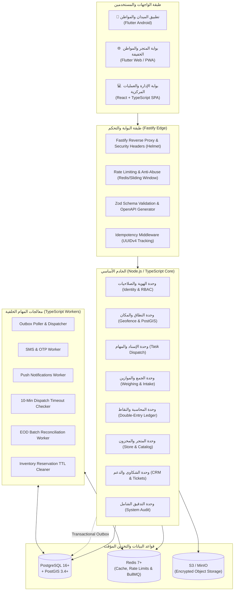
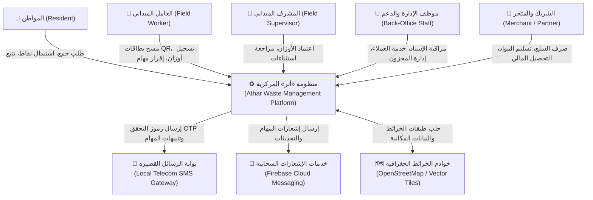
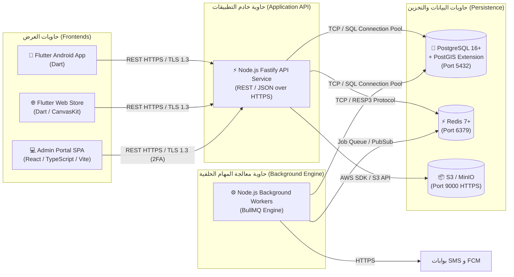
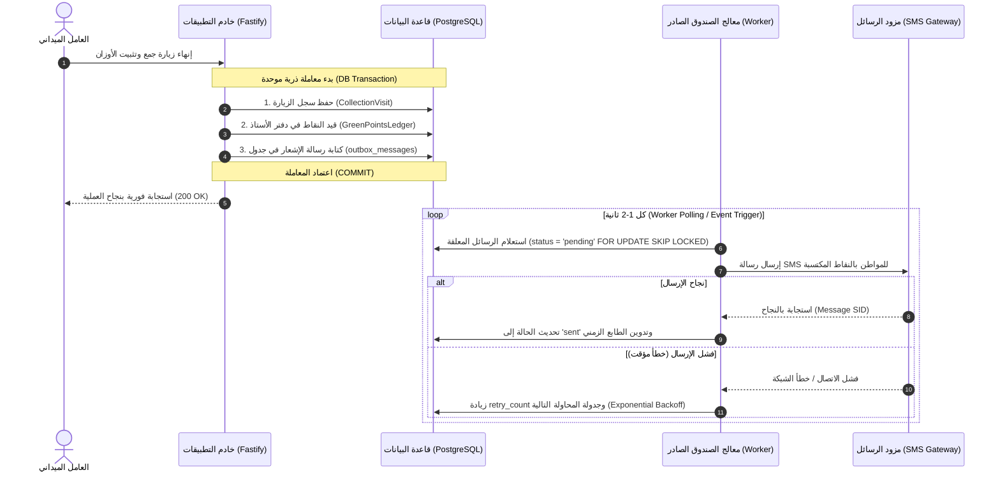
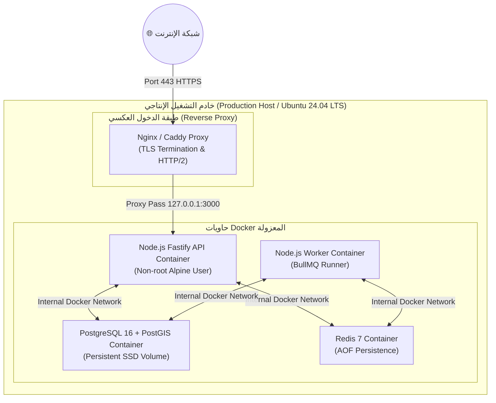

# 🏛️ معمارية النظام والهيكل العام (System Architecture Overview)

مستند التوصيف المعماري الشامل لمنظومة «أثر» لإدارة الفرز واسترداد الموارد الحضرية — **العقدة الأولى: مديرية المنصورة، عدن**.

---

## 1. الرؤية الهندسية والمبادئ المعمارية (Architectural Principles)

تعتمد منظومة «أثر» على معمارية برمجية حديثة توازن بين البساطة التشغيلية، وموثوقية الأداء الميداني، وقابلية التوسع الأفقي المستقبلي، بالاستناد إلى المبادئ الهندسية التالية:

1. **الخادم المرجعي الصارم (Server-Authoritative System):**
   * الخادم هو المصدر الوحيد للحقيقة (`Single Source of Truth`).
   * لا تُحسم أي عملية مالية، أو وزن، أو احتساب نقاط، أو استحقاق إسناد على جانب العميل (Client-side) على الإطلاق.
   * تُجرى كافة العمليات ضمن معاملات ذرية (`ACID Transactions`) مع تطبيق التحقق الصارم من الصلاحيات (`RBAC`).

2. **معمارية المونوليث النمطي (Modular Monolith Architecture):**
   * بناء الخادم الأساسي ككتلة برمجية موحدة عالية الكفاءة بلغة **TypeScript** ومحرك **Node.js** عبر إطار عمل **Fastify**.
   * عزل الوحدات الوظيفية داخل طبقات ونطاقات منطقية مستقلة (`Bounded Contexts`) تتواصل عبر واجهات برمجية وعقود داخلية واضحة (`Internal Contracts & Domain Services`).
   * تملك كل وحدة جداولها ومنطقها الخاص، مما يمهد للانتقال السلس إلى الخدمات المصغرة (`Microservices`) مستقبلاً عند زيادة الحِمل الجغرافي دون الحاجة لإعادة كتابة الكود.

3. **الاتصال المباشر مع مرونة العمل الميداني دون اتصال (Online-First with Offline Resilience):**
   * المسار الطبيعي للعمليات هو الاتصال المباشر بالإنترنت (`Online-First`).
   * في الميدان وأثناء انقطاع تغطية شبكة الهاتف في أزقة المنصورة، يدعم تطبيق العامل التخزين المحلي المشفر للبيانات، مع الترحيل المجمع نهاية الوردية (`End-of-Day Batch Import`) بعد التحقق البرمجي التام وفحص التكرار.

4. **نمط صندوق الصادر الموثوق (Transactional Outbox Pattern):**
   * فصل المهام غير المتزامنة الثقيلة (إرسال رسائل التحقق SMS، الإشعارات الموجهة Push Notifications، مطابقة الدفعات الميدانية) عن تدفق الاستجابة اللحظي للـ API.
   * كتابة الرسائل والأحداث كصفوف في جدول `outbox_messages` ضمن نفس المعاملة الذرية للعملية، ليتولى معالجو المهام الخلفية (`TypeScript Workers`) سحبها وتنفيذها بشكل غير متزامن ومضمون.

5. **المحاسبة المالية المزدوجة للنقاط (Double-Entry Points Accounting):**
   * تُعامل النقاط الخضراء كالتزام مالي حقيقي يستند إلى قيود متوازنة ($\sum Debits = \sum Credits$) بين حساب الإصدار وحساب المواطن وحساب ضمان المتجر وحساب الإتلاف، مما يمنع رياضياً أي تضخم أو تزييف في الأرصدة.

---

## 2. المكدس التقني المعتمد (Technology Stack)

### تفصيل المكونات التقنية:
| الطبقة | التقنية المعتمدة | مبرر الاختيار التقني |
| :--- | :--- | :--- |
| **الخادم الأساسي (Backend Core)** | **Node.js (LTS v20+) + TypeScript** | سرعة معالجة استثنائية لعمليات الإدخال والإخراج (`Non-blocking I/O`)، وتجانس كامل للكود بين الواجهات والخادم (`Full-Stack TypeScript`). |
| **إطار عمل الـ API** | **Fastify Framework** | سرعة معالجة تزيد بمقدار 2 إلى 4 أضعاف عن Express، تدقيق مدمج للمخططات (`JSON Schema`)، ودعم فوري لتوثيق OpenAPI. |
| **قاعدة البيانات الأساسية** | **PostgreSQL 16+** | أقوى محرك قواعد بيانات علائقية مفتوح المصدر لدعم المعاملات الذرية المعقدة وعزل المستويات المحاسبية. |
| **الامتداد المكاني الجغرافي** | **PostGIS 3.4+** | معيار الصناعة العالمي للاستعلامات المكانية، والتحقق الصارم من احتواء النطاقات الجغرافية (`ST_Covers / ST_Contains`). |
| **محرك الطوابير والـ Workers** | **BullMQ / Pg-Boss** | إدارة قوائم انتظار المهام غير المتزامنة، مع دعم مدمج لإعادة المحاولة الأسية (`Exponential Backoff`) وطوابير الرسائل المتعثرة (`DLQ`). |
| **الذاكرة المؤقتة ومحدد المعدل** | **Redis 7+** | تخزين جلسات العمل المؤقتة، تنفيذ خوارزمية النافذة المنزلقة لتحديد معدل الطلبات، وإدارة أقفال التزامن السريعة. |
| **تطبيقات الموبايل والمواطن** | **Flutter (Dart)** | قاعدة شفرة برمجية موحدة تُصرّف لتطبيق أندرويد ميداني خفيف، وتطبيق ويب تفاعلي سريع. |
| **بوابة الإدارة والعمليات** | **React + TypeScript (Vite)** | تطبيق مكتبي أحادي الصفحة (`SPA`) غني بالمكونات والجداول التفاعلية المتقدمة المخصصة للشاشات الكبيرة. |

---

## 3. مخطط سياق النظام (C4 Model - Level 1: System Context)

يوضح المخطط التالي كيفية تفاعل الفئات المختلفة من المستخدمين والأنظمة الخارجية مع منظومة «أثر»:

---

## 4. مخطط الحاويات البرمجية (C4 Model - Level 2: Container Diagram)

يوضح هذا المخطط الحاويات البرمجية الأساسية التي يتكون منها النظام وبروتوكولات التواصل بينها:

---

## 5. معمارية صندوق الصادر الموثوق (Transactional Outbox Deep-Dive)

لضمان الاتساق النهائي للبيانات وعدم فقدان أي رسالة نصية أو إشعار عند تعطل الشبكة أو فشل المزود الخارجي، تطبق المنظومة نمط **Transactional Outbox**:

### مزايا النمط:
1. **الذرية المطلقة:** يستحيل إرسال إشعار بنقاط لم تُحفظ في قاعدة البيانات، ويستحيل حفظ نقاط دون كتابة أمر إشعارها في الصندوق.
2. **استقلالية زمن الاستجابة:** زمن استجابة الـ API للعامل الميداني لا يتأثر إطلاقاً ببطء أو تعطل مزودي خدمة الـ SMS الخارجيين.
3. **التعافي الذاتي:** أي انقطاع مؤقت في بوابات الاتصالات المحلية يتم استدراكه تلقائياً بمجرد عودة الخدمة.

---

## 6. استراتيجية النشر والبيئات (Deployment & Infrastructure Blueprint)

تعتمد المنظومة على الحاويات المعيارية (`Docker Multi-Stage Builds`) لضمان خفة الحجم والأمان العالي في بيئات التشغيل:

### مؤشرات ومستويات الخدمة المستهدفة (SLIs / SLOs):
* **زمن استجابة الاستعلامات العادية:** 95% من الطلبات تُعالج خلال أقل من **50 مللي ثانية**.
* **زمن استعلامات PostGIS المكانية:** 99% من اختبارات النطاق الجغرافي تُعالج خلال أقل من **40 مللي ثانية**.
* **جاهزية النظام (Uptime SLO):** 99.9% جاهزية تشغيلية على مدار الشهر.
* **التعافي من الكوارث:** هدف استعادة البيانات (**RPO**) أقل من **15 دقيقة** عبر النسخ الاحتياطي المستمر لملفات WAL (`Write-Ahead Logging`)، وزمن استعادة الخدمة (**RTO**) أقل من **ساعتين**.
