# 🗄️ مخطط علاقات الكيانات وقاعدة البيانات (Entity Relationship Diagram - ERD)

يوثق هذا المستند النموذج العلائقي الموحد لقاعدة بيانات منظومة «أثر» المبنية على **PostgreSQL 16+** مع امتداد **PostGIS 3.4+**، شاملاً الكيانات الـ 28 المعتمدة، المفاتيح الأساسية والأجنبية، وضوابط التكامل المرجعي.

---

## 1. المخطط العام للعلاقات (Comprehensive ERD)

```mermaid
erDiagram
    %% Identity & Access
    USER_ACCOUNT ||--o| ADMIN_STAFF_PROFILE : "has admin profile"
    USER_ACCOUNT ||--o{ HOUSEHOLD : "owns"
    USER_ACCOUNT ||--o{ WORKER_TASK_DISPATCH : "assigned as worker"
    USER_ACCOUNT ||--o{ AUDIT_LOG : "triggers actions"
    
    %% Citizen & Household Domain
    HOUSEHOLD ||--o{ INTAKE_SURVEY : "fills"
    HOUSEHOLD ||--o{ HOUSEHOLD_QR_TOKEN : "issued cards"
    HOUSEHOLD ||--o{ SERVICE_REQUEST : "requests collection"
    HOUSEHOLD ||--o{ COLLECTION_VISIT : "receives visits"
    HOUSEHOLD ||--o{ STORE_ORDER : "places orders"
    HOUSEHOLD ||--o{ INCIDENT_REPORT : "reports issues"
    
    %% Geospatial Domain
    ACTIVE_NODE ||--o{ HOUSEHOLD : "contains location"
    ACTIVE_NODE ||--o{ SERVICE_REQUEST : "geofence boundary"
    ACTIVE_NODE ||--o{ REJECTED_SERVICE_ATTEMPT : "boundary reference"
    
    %% Dispatch & Collection Operations
    SERVICE_REQUEST ||--o{ WORKER_TASK_DISPATCH : "dispatches task"
    WORKER_TASK_DISPATCH ||--o| COLLECTION_VISIT : "results in visit"
    COLLECTION_VISIT ||--|{ COLLECTION_ITEM : "contains weighed items"
    FIELD_BATCH_IMPORT ||--o{ COLLECTION_VISIT : "imports offline visits"
    FIELD_BATCH_IMPORT ||--o{ FIELD_BATCH_ROW_ERROR : "logs row errors"
    
    %% Double-Entry Green Points Ledger
    COLLECTION_VISIT ||--o{ GREEN_POINTS_LEDGER : "mints points"
    STORE_ORDER ||--o{ GREEN_POINTS_LEDGER : "redeems/burns points"
    HOUSEHOLD ||--o{ GREEN_POINTS_LEDGER : "account debited/credited"
    
    %% Store & Inventory
    STORE_PRODUCT ||--o{ STORE_ORDER : "ordered items"
    
    %% Partners & Commercial Operations
    RESOURCE_PARTNER ||--o{ COLLECTION_POINT : "operates points"
    RESOURCE_PARTNER ||--o{ PARTNER_DELIVERY : "receives waste delivery"
    RESOURCE_PARTNER ||--o{ PARTNER_PAYMENT : "financial settlement"
    MATERIAL_PRICE ||--o{ PARTNER_DELIVERY : "applies tariff"
    
    %% System Infrastructure
    USER_ACCOUNT ||--o{ AUDIT_LOG : "triggers actions"

    %% Entity Definitions with Attributes
    USER_ACCOUNT {
        uuid id PK
        varchar phone_bidx "Blind Index"
        text phone_encrypted "AES-256-GCM"
        varchar role_scope "citizen/worker/admin"
        enum status "active/suspended"
        timestamptz phone_verified_at
        timestamptz created_at
    }

    ADMIN_STAFF_PROFILE {
        uuid id PK
        uuid user_account_id FK
        varchar staff_code UK "Unique Employee Code"
        text full_name
        enum department "operations/support/warehouse/finance"
        enum role "dispatcher/support_agent/store_mgr/auditor"
        boolean two_factor_enabled
        text two_factor_secret_enc
        boolean is_active
    }

    HOUSEHOLD {
        uuid id PK
        varchar entity_code UK "5-6 Chars Human Readable"
        uuid owner_user_id FK
        enum entity_type "household/commercial/individual"
        text address_text
        geometry location_point "PostGIS Point 4326"
        enum status "active/blocked"
    }

    HOUSEHOLD_QR_TOKEN {
        uuid id PK
        uuid household_id FK
        varchar token_hash UK "Cryptographic Card Token Hash"
        varchar card_serial UK "Physical Card Serial"
        enum status "active/revoked"
        timestamptz revoked_at
        timestamptz issued_at
    }

    ACTIVE_NODE {
        uuid id PK
        text name "المنصورة - العقدة 1"
        geometry boundary_polygon "PostGIS MultiPolygon"
        integer boundary_version "Immutable Version"
        enum status "active/archived"
    }

    SERVICE_REQUEST {
        uuid id PK
        uuid household_id FK
        uuid active_node_id FK
        geometry location_point "PostGIS Point"
        enum status "submitted/assigned/completed/cancelled"
        timestamptz requested_at
    }

    COLLECTION_VISIT {
        uuid id PK
        uuid task_dispatch_id FK
        uuid household_id FK
        uuid worker_user_id FK
        numeric total_organic_kg "12,3"
        numeric total_dry_kg "12,3"
        numeric total_rejected_kg "12,3"
        text scale_device_ref
        text proof_photo_url
        enum status "approved/flagged/rejected"
        timestamptz visited_at
    }

    COLLECTION_ITEM {
        uuid id PK
        uuid collection_visit_id FK
        enum waste_stream "organic/dry"
        numeric gross_weight_kg "12,3"
        numeric tare_weight_kg "12,3"
        numeric net_weight_kg "12,3"
    }

    GREEN_POINTS_LEDGER {
        uuid id PK
        uuid debit_account_id FK "Mint/Household/Escrow"
        uuid credit_account_id FK "Household/Escrow/Burn"
        numeric amount "12,2 Points"
        numeric balance_after "12,2 Points"
        enum entry_type "mint_weight/redeem_order/reversal"
        uuid correlation_id "Visit or Order ID"
        timestamptz created_at
    }

    WORKER_TASK_DISPATCH {
        uuid id PK
        uuid service_request_id FK
        uuid worker_user_id FK
        enum status "pending/acknowledged/timeout/completed"
        timestamptz dispatch_deadline_at "10 Min SLA"
        timestamptz acknowledged_at
    }

    STORE_PRODUCT {
        uuid id PK
        text title_ar
        numeric points_price "Points Required"
        numeric cash_price_yer "Optional Mixed Cash"
        integer stock_quantity "Atomic Quantity"
        boolean is_active
    }

    STORE_ORDER {
        uuid id PK
        varchar order_number UK
        uuid buyer_household_id FK
        uuid store_product_id FK
        integer quantity
        numeric total_points
        enum status "draft/reserved/payment_verified/released/cancelled"
        text payment_receipt_url
        text payment_reference_no
        text release_order_code
        timestamptz reserved_until "Stock Reservation TTL"
    }

    INCIDENT_REPORT {
        uuid id PK
        uuid actor_id FK
        varchar target_type "VISIT / TASK / ORDER / CARD"
        uuid target_id
        varchar incident_type "ANOMALY / DELAY / LOST_CARD / GENERAL"
        text description
        text evidence_reference
        enum status "new/triaged/resolved/closed"
        text resolution_notes
        timestamptz resolved_at
    }

    CANDIDATE_APPLICATION {
        uuid id PK
        uuid user_account_id FK
        varchar full_name
        varchar national_id
        varchar phone
        text cv_file_url
        enum status "submitted/reviewed/accepted/rejected"
        timestamptz applied_at
    }

    VOLUNTEER_INTEREST {
        uuid id PK
        uuid user_account_id FK
        varchar area
        timestamptz consent_at
        enum status "registered/contacted"
        timestamptz contacted_at
    }

    AUDIT_LOG {
        uuid id PK
        uuid actor_user_id FK
        varchar actor_role
        varchar action_name "REASSIGN_TASK/REVOKE_CARD/RELEASE_ORDER"
        text resource_name
        uuid resource_id
        jsonb before_data
        jsonb after_data
        varchar ip_address
        timestamptz occurred_at
    }
```



---

## 2. المجموعات النطاقية للبيانات (Bounded Contexts)

تنتظم الجداول الـ 25 المعتمدة داخل 6 مجموعات وظيفية متماسكة تحقق استقلالية الوحدات (`High Cohesion & Low Coupling`):

1. **نطاق الهوية والأمان (Identity & Security Context):**
   * `USER_ACCOUNT`: الحساب الرئيسي للمستخدم مع التشفير والفهرس المعمي للهاتف.
   * `ADMIN_STAFF_PROFILE`: بيانات موظفي الإدارة، الأقسام، والأدوار، والمصادقة الثنائية 2FA.
   * `AUDIT_LOG`: سجل التدقيق المؤسسي غير القابل للحذف.
2. **نطاق المستفيدين والبيانات المكانية (Citizen & Spatial Context):**
   * `HOUSEHOLD`: المنشأة أو الأسرة المرتبطة بالمعرّف المحاسبي القصير `entity_code`.
   * `INTAKE_SURVEY`: استبيان الضم ومسودة الأسرة.
   * `HOUSEHOLD_QR_TOKEN`: الرموز البصرية للبطاقات الفيزيائية وحالات إبطالها.
   * `ACTIVE_NODE`: حدود النطاق الجغرافي للمنصورة ونسخ المضلعات المكانية المؤرخة.
   * `REJECTED_SERVICE_ATTEMPT`: محاولات طلب الخدمة المرفوضة خارج النطاق.
   * `DEMAND_WAITLIST`: قائمة انتظار المواطنين في المناطق غير المغطاة بعد.
3. **نطاق العمليات الميدانية والإسناد (Field Dispatch & Intake Context):**
   * `SERVICE_REQUEST`: طلبات الجمع الرسمية المعتمدة داخل النطاق.
   * `WORKER_TASK_DISPATCH`: مهام الإسناد للعمال ومراقبة مهلة الاستجابة (10 دقائق).
   * `COLLECTION_VISIT`: زيارات الجمع وتثبيت الأوزان المفرزة (عضوي، جاف، مرفوض).
   * `COLLECTION_ITEM`: تفاصيل أوزان المسارين (عضوي وجاف) والمرفوض المستبعد.
   * `FIELD_BATCH_IMPORT`: حزم استيراد دفعات العمل الميداني غير المتصل (Offline EOD CSV).
   * `FIELD_BATCH_ROW_ERROR`: الأخطاء المعزولة للصفوف الميدانية.
4. **نطاق دفتر الأستاذ والمحاسبة المزدوجة (Financial & Points Ledger Context):**
   * `GREEN_POINTS_LEDGER`: دفتر القيود المزدوجة المتوازنة (Debit/Credit).
5. **نطاق المتجر والمخزون والتوريد (Store & Inventory Context):**
   * `STORE_PRODUCT`: كتالوج السلع المدعومة وأسعارها بالنقاط والمبالغ النقدية ومخزونها.
   * `STORE_ORDER`: دورة حياة طلب المتجر، حجز المخزون، وإثبات الدفع، وأمر الصرف (`Release Order`).
6. **نطاق الشركاء والبلاغات والمجتمع (Partners & Community Context):**
   * `RESOURCE_PARTNER`: بيانات مصانع ومستودعات التدوير الشريكة.
   * `COLLECTION_POINT`: نقاط ومحطات التجميع الوسيطة.
   * `MATERIAL_PRICE`: تسعيرة شراء وبيع المواد المفروزة بالكيلوجرام.
   * `PARTNER_DELIVERY`: شحنات تسليم المواد للشركاء.
   * `PARTNER_PAYMENT`: مطالبات ومستحقات التحصيل المالي للشركاء.
   * `INCIDENT_REPORT`: بلاغات الحوادث والاعتراضات واستثناءات الأوزان.
   * `CANDIDATE_APPLICATION`: طلبات التوظيف.
   * `VOLUNTEER_INTEREST`: تسجيل الرغبة في التطوع المجتمعي.

---

## 3. الفهارس المتقدمة والتحسينات المكانية (PostGIS & Indexing Strategy)

لضمان تحقيق أهداف مستوى الخدمة (`< 50ms` لزمن الاستجابة)، تُطبق استراتيجية الفهرسة التالية في PostgreSQL:

```sql
-- 1. فهارس مكانية GiST لعمليات التحقق المكاني السريع
CREATE INDEX idx_active_node_boundary_gist ON active_nodes USING GIST (boundary_polygon);
CREATE INDEX idx_household_location_gist ON households USING GIST (location_point);
CREATE INDEX idx_service_request_location_gist ON service_requests USING GIST (location_point);

-- 2. فهرس معمي HMAC للبحث السريع عن الهواتف المشفرة دون فك التشفير
CREATE INDEX idx_user_account_phone_bidx ON user_accounts (phone_bidx);

-- 3. فهارس دفتر النقاط المزدوج ومطابقة الأرصدة
CREATE INDEX idx_ledger_debit_account ON green_points_ledger (debit_account_id, created_at);
CREATE INDEX idx_ledger_credit_account ON green_points_ledger (credit_account_id, created_at);
CREATE INDEX idx_ledger_correlation ON green_points_ledger (correlation_id);
```
