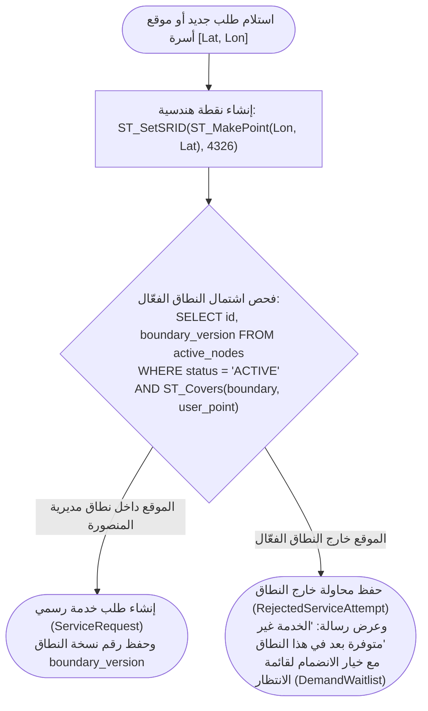
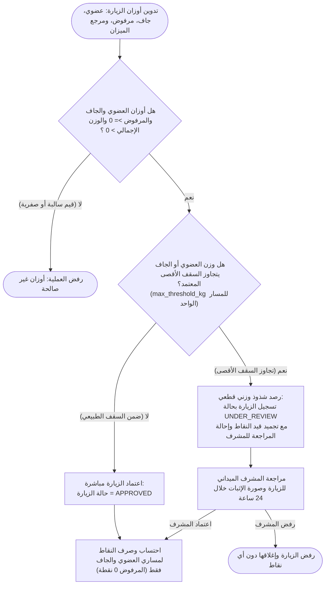
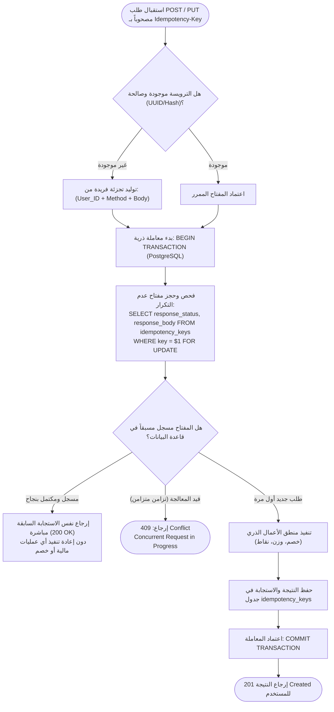

# منطق الأعمال والخوارزميات المحورية (Business Logic & Core Algorithms)
## منصة «أثر» — بلدية المنصورة (العقدة التشغيلية الأولى)

توثق هذه الوثيقة الخوارزميات والمعادلات الرياضية ومنطق اتخاذ القرار المحوري المطبق في خوادم Node.js / Fastify وقاعدة بيانات PostgreSQL لضمان نزاهة العمليات الميدانية والمالية.

---

## 1. خوارزمية التحقق المكاني والنطاقات الجغرافية (Spatial Geofencing Logic)

تضمن هذه الخوارزمية أن طلبات الجمع وتواجد العمال تقع حصرياً داخل النطاق الجغرافي المصرح به لمديرية المنصورة باستخدام الامتداد المكاني PostGIS مع حفظ رقم إصدار النطاق.



### الاستعلام المكاني المعتمد في Fastify / PostGIS:
```sql
SELECT 
    an.id AS node_id,
    an.name AS node_name,
    an.boundary_version
FROM active_nodes an
WHERE an.status = 'ACTIVE'
  AND ST_Covers(an.boundary, ST_SetSRID(ST_MakePoint($1, $2), 4326))
LIMIT 1;
```

---

## 2. محرك فحص الأوزان وكشف الشذوذ (Weight Verification & Anomaly Engine)

تضمن هذه الخوارزمية انضباط الأوزان المدونة لمساري الفرز (عضوي وجاف) والمرفوض، ومنع تسجيل أوزان غير معقولة تتجاوز السقف الأقصى المعتمد للزيارة.



---

## 3. آلية تجنب تكرار العمليات عبر مفاتيح عدم التكرار (ACID Idempotency Engine)

تطبق المنصة حماية متقدمة وموثوقة لمنع تكرار العمليات المالية والتشغيلية عبر ترويسة `Idempotency-Key` المستندة إلى معاملات وقفل PostgreSQL الذري (جدول 31 من الوثيقة المرجعية).



---

## 4. معادلة القيد المزدوج للنقاط الخضراء (Double-Entry Balance Rules)

لا يتم إنشاء أي نقطة خضراء (`Green Point`) في النظام دون قيد متوازن دائن ومدين؛ مما يمنع رياضياً أي اختلال في ميزان المدفوعات.

### 4.1 معادلة الإنشاء على أوزان الفرز المعتمدة (Recycling Minting):
الفرز عند المصدر مساران: **عضوي وجاف**؛ والمرفوض وزن مستبعد لا تنشأ عنه أي نقاط:
$$\Delta P = \lfloor W_{\text{organic}} \times R_{\text{organic}} \rfloor + \lfloor W_{\text{dry}} \times R_{\text{dry}} \rfloor$$
$$\Delta P_{\text{rejected}} = 0$$

**القيد المحاسبي المتولد:**
* **الطرف الدائن (Source Account):** `SYSTEM_MINT_ACCOUNT` ($\Delta P -$)
* **الطرف المدين (Destination Account):** `HOUSEHOLD_ACCOUNT` ($\Delta P +$)

### 4.2 معادلة استبدال وشراء منتجات المتجر بالنقاط (Store Product Redemption):
عند استبدال المواطن لنقاطه مقابل منتجات وسلع صديقة للبيئة من المتجر بتكلفة $P_{\text{spent}}$:
* **الطرف الدائن (Source Account):** `HOUSEHOLD_ACCOUNT` ($P_{\text{spent}} -$)
* **الطرف المدين (Destination Account):** `SYSTEM_BURN_ACCOUNT` ($P_{\text{spent}} +$)

### 4.3 معادلة إلغاء الطلب واسترداد النقاط (Order Cancellation & Points Rollback):
في حال رفض الإشعار المالي أو إلغاء الطلب قبل التجهيز:
* **قيد الاسترداد العكسي المتوازن:**
  * **الطرف الدائن (Source Account):** `SYSTEM_BURN_ACCOUNT` ($P_{\text{spent}} -$)
  * **الطرف المدين (Destination Account):** `HOUSEHOLD_ACCOUNT` ($P_{\text{spent}} +$)
* يعود رصيد المواطن فوراً كما كان دون أي نقص، ويوثق ذلك في `green_points_ledger` ببيان `ORDER_CANCELLED_REFUND`.
