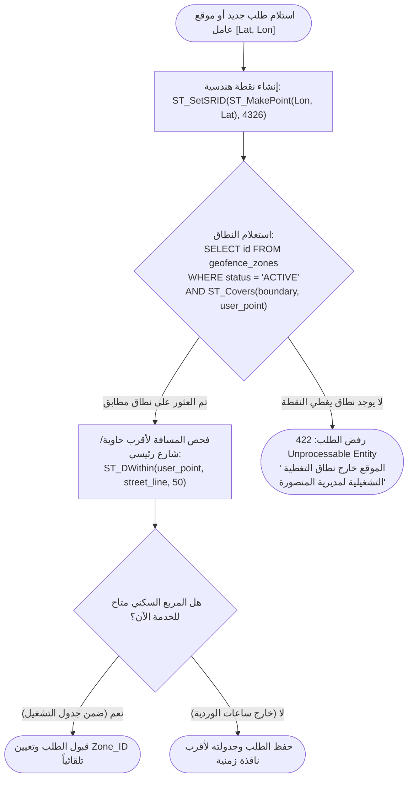
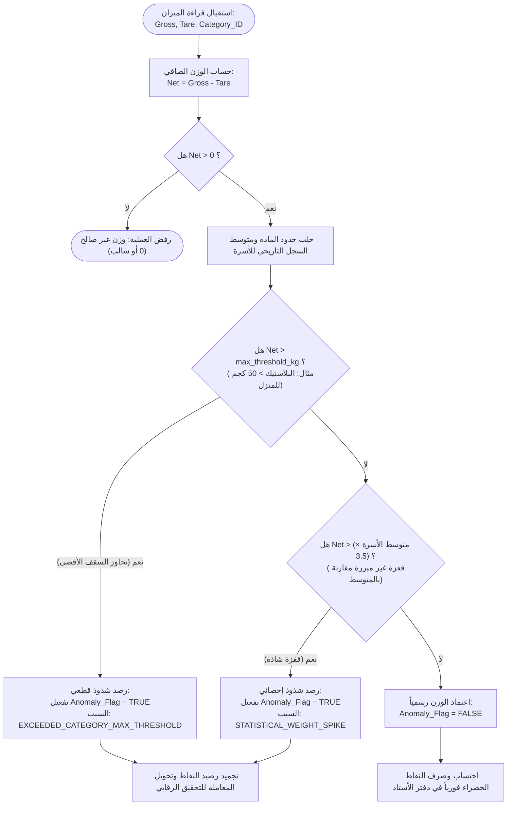
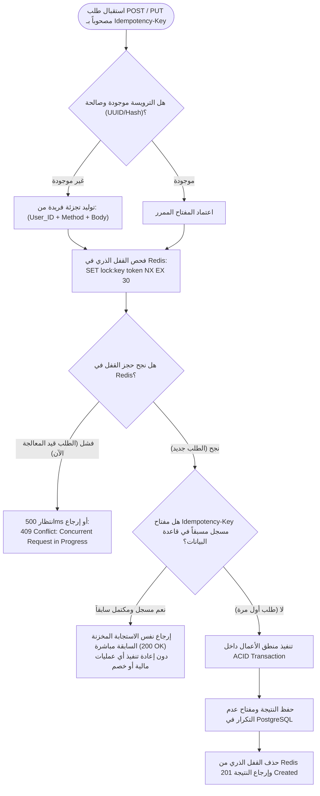

# منطق الأعمال والخوارزميات المحورية (Business Logic & Core Algorithms)
## منصة «أثر» — بلدية المنصورة (العقدة التشغيلية الأولى)

توثق هذه الوثيقة الخوارزميات والمعادلات الرياضية ومنطق اتخاذ القرار المحوري المطبق في خوادم Node.js / Fastify وقاعدة بيانات PostgreSQL لضمان نزاهة العمليات الميدانية والمالية.

---

## 1. خوارزمية التحقق المكاني والنطاقات الجغرافية (Spatial Geofencing Logic)

تضمن هذه الخوارزمية أن طلبات الجمع المنزلي وتواجد عمال النظافة تقع حصرياً داخل النطاق الجغرافي المصرح به لحي المنصورة والمربعات السكنية التابعة له.



### الاستعلام المكاني المعتمد في Fastify / PostGIS:
```sql
SELECT 
    gz.id AS zone_id,
    gz.name AS zone_name,
    gz.code AS zone_code
FROM geofence_zones gz
WHERE gz.status = 'ACTIVE'
  AND ST_Covers(gz.boundary, ST_SetSRID(ST_MakePoint($1, $2), 4326))
LIMIT 1;
```

---

## 2. محرك كشف الشذوذ ومكافحة الاحتيال في الأوزان (Anti-Fraud Weight Engine)

تمنع هذه الخوارزمية محاولات التلاعب بالموازين، مثل وضع أحجار أو معادن ثقيلة داخل أكياس البلاستيك، أو تسجيل أوزان وهمية من قِبل العمال لزيادة النقاط بشكل غير مشروع.



---

## 3. آلية تجنب تكرار العمليات عبر مفاتيح عدم التكرار (Distributed Idempotency Engine)

نظراً لتذبذب شبكة الإنترنت في الميدان (3G/4G)، قد يضغط المستخدم أو العامل زر الإرسال مرتين، أو يعيد تطبيق Flutter المحاولة تلقائياً. تطبق المنصة حماية متقدمة عبر مفتاح `Idempotency-Key`.



---

## 4. معادلة القيد المزدوج للنقاط الخضراء (Double-Entry Balance Rules)

لا يتم إنشاء أي نقطة خضراء (`Green Point`) في النظام دون قيد متوازن دائن ومدين؛ مما يمنع رياضياً أي اختلال في ميزان المدفوعات.

### 4.1 معادلة الإنشاء الأولي (Recycling Minting):
عند تسليم $W$ كيلوغرام من مادة ذات معامل نقاط $R$:
$$\Delta P = \lfloor W_{\text{net}} \times R_{\text{category}} \rfloor$$

**القيد المحاسبي المتولد:**
* **الطرف الدائن (Source Account):** `SYSTEM_MINT_ACCOUNT` ($\Delta P -$)
* **الطرف المدين (Destination Account):** `HOUSEHOLD_ACCOUNT` ($\Delta P +$)

### 4.2 معادلة استبدال وشراء منتجات المتجر بالنقاط (Store Product Redemption):
عند استبدال المواطن لنقاطه مقابل منتجات وسلع صديقة للبيئة من المتجر بتكلفة $P_{\text{spent}}$:
* **الطرف الدائن (Source Account):** `HOUSEHOLD_ACCOUNT` ($P_{\text{spent}} -$)
* **الطرف المدين (Destination Account):** `SYSTEM_BURN_ACCOUNT` ($P_{\text{spent}} +$)

### 4.3 معادلة إلغاء الطلب واسترداد النقاط (Order Cancellation & Points Rollback):
في حال رفض الإشعار المالي أو إلغاء الطلب قبل التجهيز:
* **قيد الاسترداد العكسي المتوازن:**
  * **الطرف الدائن (Source Account):** `SYSTEM_BURN_ACCOUNT` ($P_{\text{spent}} -$)
  * **الطرف المدين (Destination Account):** `HOUSEHOLD_ACCOUNT` ($P_{\text{spent}} +$)
* يعود رصيد المواطن فوراً كما كان دون أي نقص، ويوثق ذلك في `green_points_ledger` ببيان `ORDER_CANCELLED_REFUND`.
