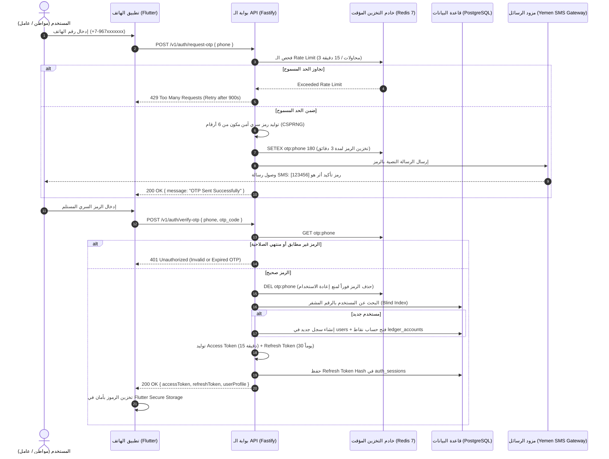
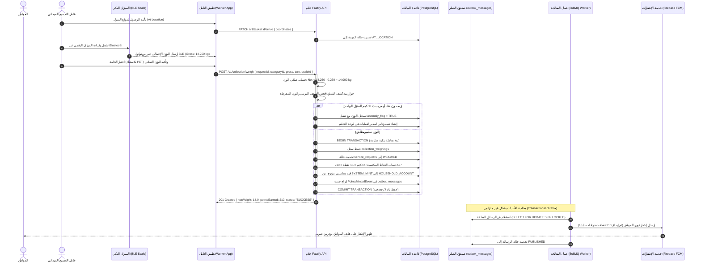
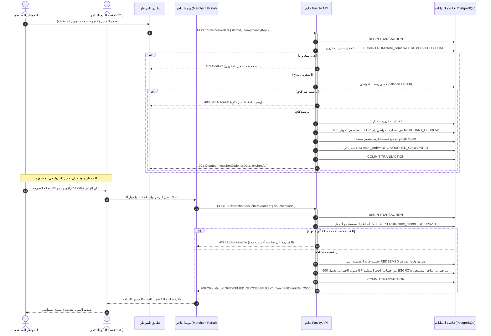
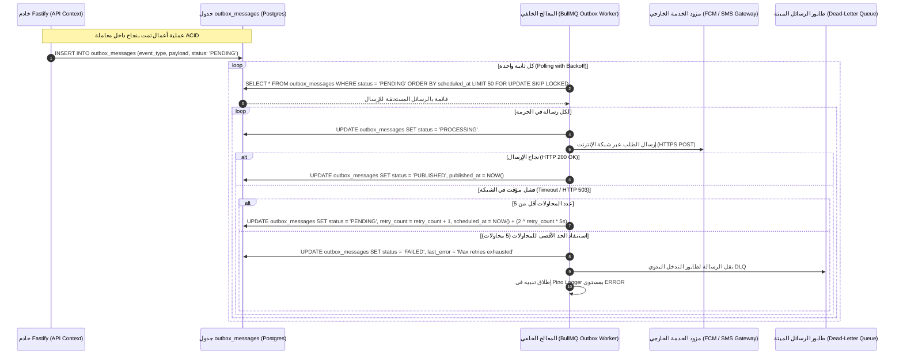

# مخططات التتابع الزمني للعمليات (System Sequence Diagrams)
## منصة «أثر» — بلدية المنصورة (العقدة التشغيلية الأولى)

توثق هذه الصفحة التتابعات الزمنية وتدفق البيانات بين مختلف طبقات النظام (تطبيقات الجوال، لوحة التحكم، خوادم Fastify، قاعدة بيانات PostgreSQL، وطوابير BullMQ) لأهم أربع عمليات حرجة في المنصة.

---

## 1. مخطط تسجيل الدخول بالرمز المؤقت والتدوير الآمن للرموز (Passwordless OTP & Token Rotation)

يوضح هذا المخطط آلية الدخول دون كلمة مرور عبر الرسائل القصيرة (SMS OTP) مع تحديد معدل الطلبات (Rate Limiting) وتدوير الرموز المميزة (Refresh Token Rotation).

### القرارات المعمارية المطبقة:
* **تخزين الرموز المؤقتة في الذاكرة (Redis TTL):** تنتهي صلاحية الرمز تلقائياً بعد 180 ثانية، ويُحذف فور التحقق لمنع هجمات الإعادة (Replay Attacks).
* **الفهرسة العمياء للخصوصية:** لا يُبحث عن رقم الهاتف كنص صريح بل عبر قيمة `phone_bindex` المجزأة بتشفير HMAC لضمان سرية هوية المواطنين.

---

## 2. دورة حياة الجمع الميداني، الوزن الذكي، وضبط الرصيد (Smart Field Collection & Weighing Flow)

توثق هذه العملية كيفية إتمام استلام النفايات من قبل عامل النظافة الميداني، والاتصال بالميزان الذكي عبر Bluetooth، والتحقق التلقائي من الشذوذ، وتسجيل النقاط بالقيد المزدوج المضمون.

---

## 3. شراء واستبدال قسائم المكافآت الرقمية (Store Voucher Generation & POS Redemption)

يوضح هذا المخطط كيفية استبدال النقاط المكتسبة بقسائم خصم رقمية لدى المتاجر والشركاء في حي المنصورة بنظام الحجز المعلق (Escrow).

---

## 4. مشغل صندوق الصادر وضمان تسليم الإشعارات (Transactional Outbox Dispatcher Worker)

يوضح هذا المخطط الآلية المعمارية التي تضمن وصول الرسائل والإشعارات الميدانية دون أي احتمالية لفقدان البيانات حتى لو انقطعت شبكة الإنترنت أو تعطل مزود الرسائل الخارجي.

### مزايا هذا النمط:
1. **استقلالية الـ API:** لا ينتظر خادم الـ API استجابة مزود الرسائل الخارجي، مما يجعل وقت الاستجابة للمستخدمين أقل من 40 ميلي ثانية.
2. **منع الإرسال الوهمي:** لا تُرسل أي رسالة إشعار إطلاقاً إذا فشلت المعاملة المالية في قاعدة البيانات، لأن حفظ الرسالة في الصندوق جزء من نفس المعاملة المصرفية التلقائية.
3. **تجنب التنافس (SKIP LOCKED):** يمكن تشغيل 10 نسخ من الـ Workers بالتوازي دون أن تعالج نسختان نفس الرسالة في نفس الوقت.
