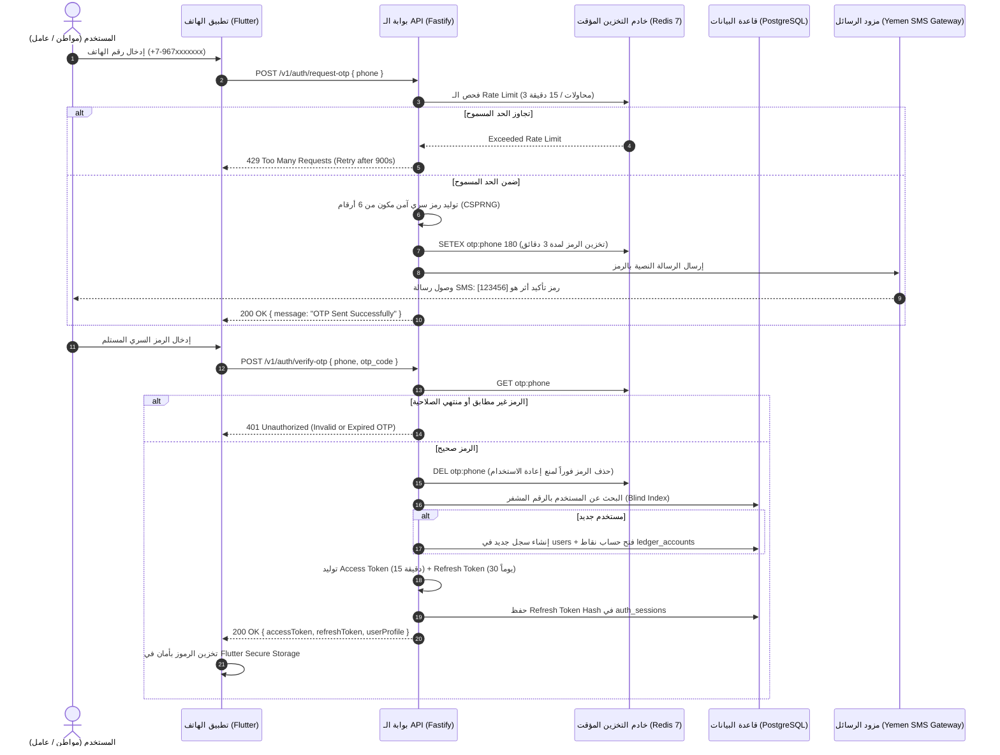
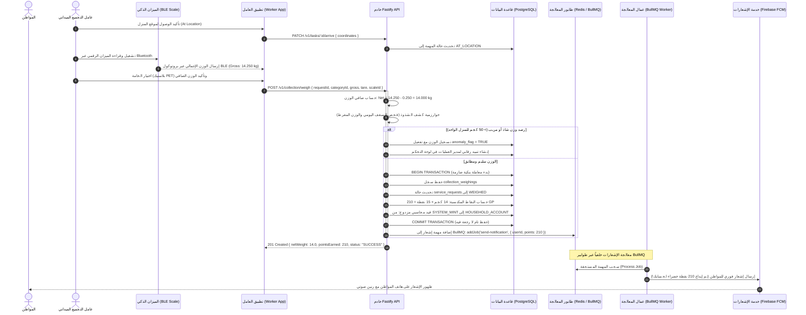
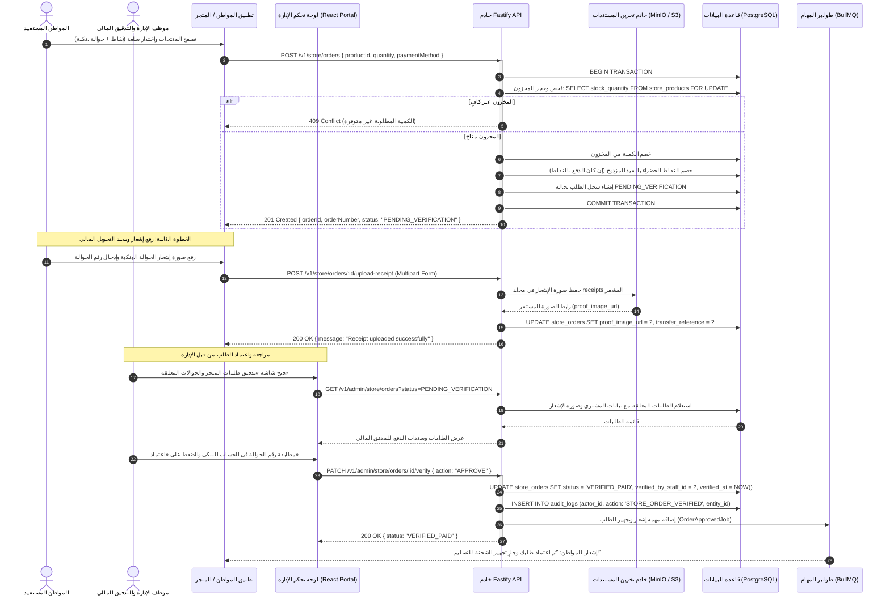
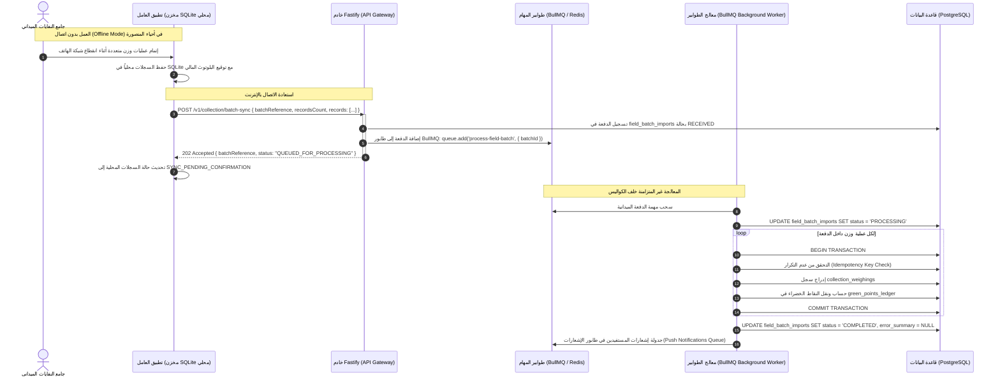

# مخططات التتابع الزمني للعمليات (System Sequence Diagrams)
## منصة «أثر» — بلدية المنصورة (العقدة التشغيلية الأولى)

توثق هذه الصفحة التتابعات الزمنية وتدفق البيانات بين مختلف طبقات النظام (تطبيقات الجوال، لوحة التحكم، خوادم Fastify، قاعدة بيانات PostgreSQL، وطوابير BullMQ) لأهم أربع عمليات حرجة في المنصة.

---

## 1. مخطط تسجيل الدخول بالرمز المؤقت والتدوير الآمن للرموز (Passwordless OTP & Token Rotation)

يوضح هذا المخطط آلية الدخول دون كلمة مرور عبر الرسائل القصيرة (SMS OTP) مع تحديد معدل الطلبات (Rate Limiting) وتدوير الرموز المميزة (Refresh Token Rotation).

### القرارات المعمارية المطبقة:
* **تخزين الرموز المؤقتة في الذاكرة (Redis TTL):** تنتهي صلاحية الرمز تلقائياً بعد 180 ثانية، ويُحذف فور التحقق لمنع هجمات الإعادة (Replay Attacks).
* **الفهرسة العمياء للخصوصية:** لا يُبحث عن رقم الهاتف كنص صريح بل عبر قيمة `phone_bindex` المجزأة بتشفير HMAC لضمان سرية هوية المواطنين.

---

## 2. دورة حياة الجمع الميداني، الوزن الذكي، وضبط الرصيد (Smart Field Collection & Weighing Flow)

توثق هذه العملية كيفية إتمام استلام النفايات من قبل عامل النظافة الميداني، والاتصال بالميزان الذكي عبر Bluetooth، والتحقق التلقائي من الشذوذ، وتسجيل النقاط بالقيد المزدوج المضمون.

---

## 3. شراء منتجات المتجر بالتحقق الثنائي والتدقيق المالي (Store Order & Two-Step Verification Flow)

يوضح هذا المخطط دورة شراء واستبدال السلع البيئية عبر المتجر، ورفع إشعار التحويل البنكي، والتدقيق المالي والاعتماد من قبل موظفي الإدارة في لوحة التحكم (Back-Office Portal).

---

## 4. مزامنة الدفعات الميدانية غير المتصلة وطوابير المعالجة الخلفية (Field Batch Sync & Background Queue Workers)

يوضح هذا المخطط الآلية المعمارية المعتمدة لمعالجة البيانات عند انقطاع التغطية الميدانية في مناطق عدن، حيث يحفظ التطبيق الميداني العمليات محلياً (SQLite)، ثم يقوم بالمزامنة الدفيعية فور توفر الشبكة لتعالجها طوابير BullMQ دون تحميل خادم الـ API أي بطء.

### مزايا هذا النمط:
1. **استجابة فورية فائقة السرعة (Under 30ms):** يرد الخادم برمز `202 Accepted` مباشرة دون حظر تطبيق العامل أثناء تفريغ مئات الأوزان.
2. **عزل الأعطال:** إذا تعطلت معالجة قيد محاسبي لأحد الأوزان، تُعزل السجلات الفاشلة وتُسجل في `error_summary` دون إفشال باقي عمليات الدفعة.
3. **مرونة التوسع (Horizontal Scalability):** يمكن تشغيل عدة حاويات من `BullMQ Background Worker` لمعالجة دفعات عشرات الشاحنات المتزامنة دون المساس بسرعة تصفح المواطنين للنظام.
