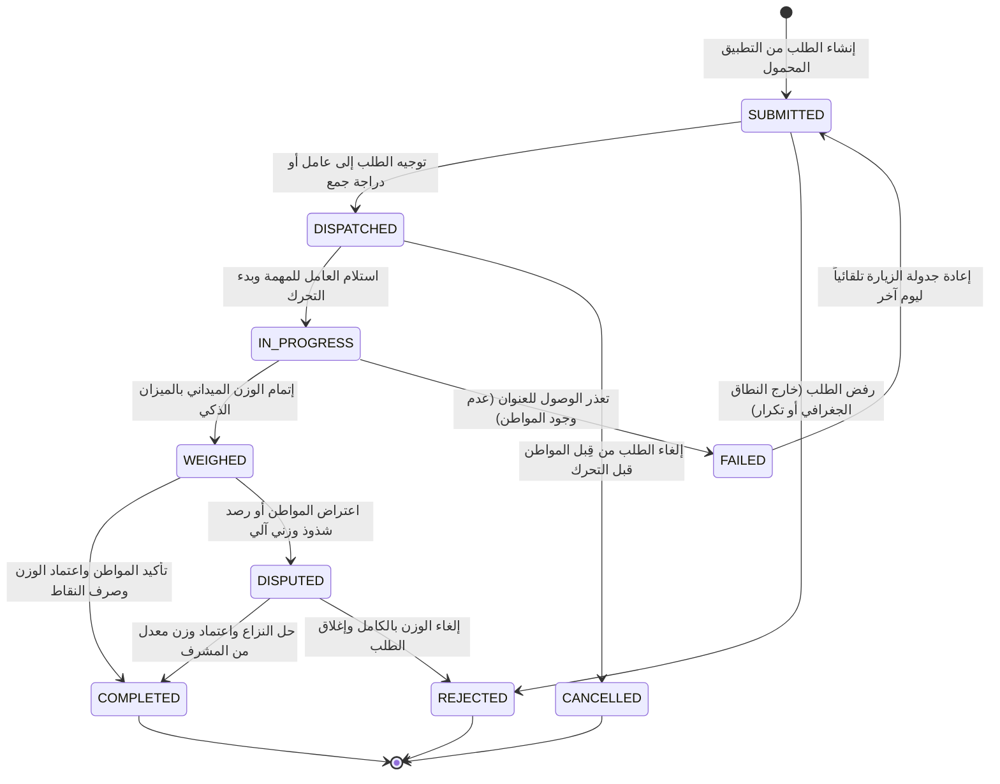
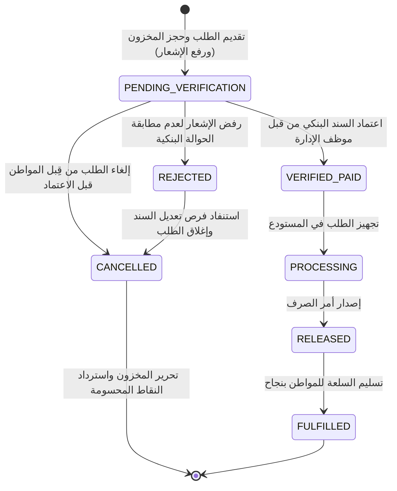
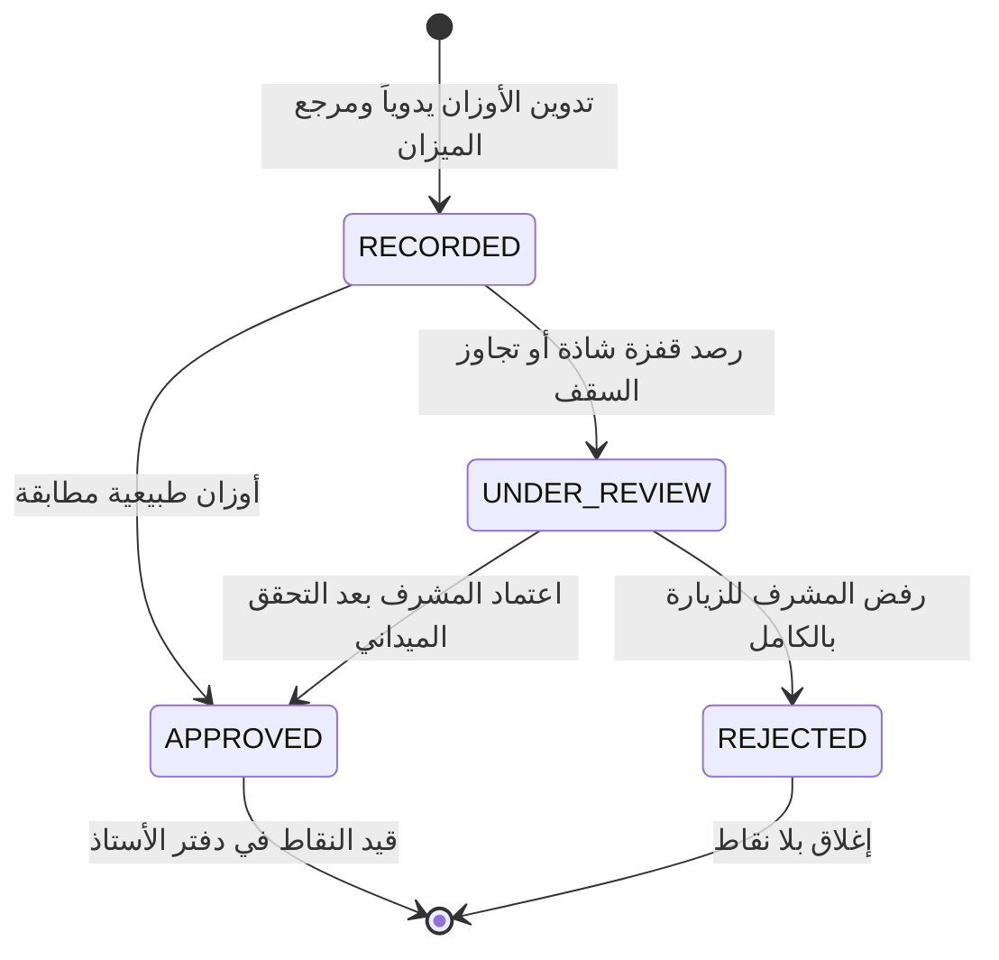
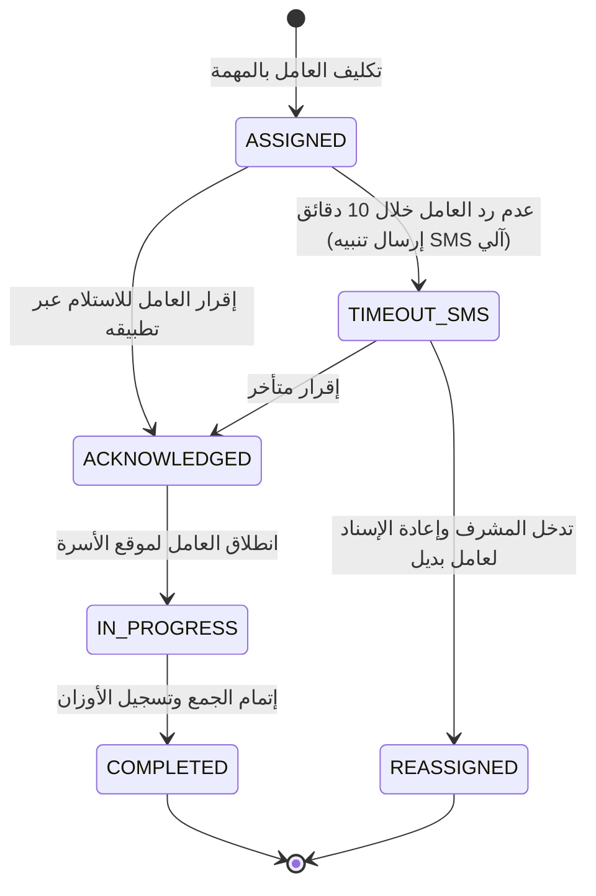
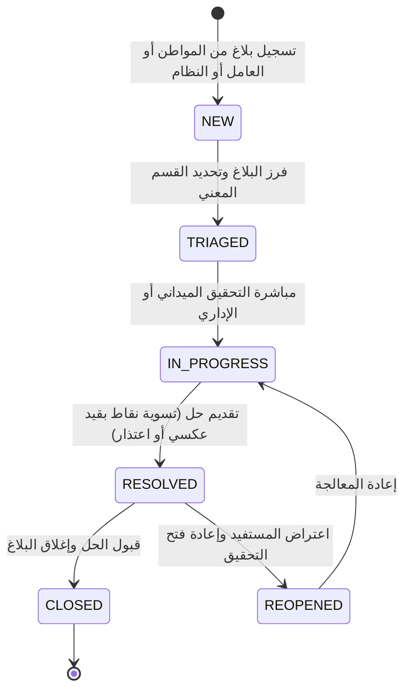

# آلات الحالة المحددة (Finite State Machines - FSM)
## منصة «أثر» — بلدية المنصورة (العقدة التشغيلية الأولى)

تعتمد منصة «أثر» على مفهوم **آلات الحالة المحددة (Finite State Machines)** لضبط انتقال دورات حياة الكيانات الحيوية الصارمة. لا يُسمح بأي انتقال عشوائي بين الحالات؛ بل يتم التحكم بكل انتقال عبر شروط مسبقة (Pre-conditions) وأحداث ناتجة (Side-effects) مسجلة في سجل الرقابة.

---

## 1. آلة حالة طلب خدمة استلام النفايات (`service_requests`)

تتحكم هذه الآلة في مسار جمع النفايات المنزلية من لحظة إنشاء الطلب في تطبيق المواطن وحتى الصرف النهائي للنقاط أو تسوية النزاعات.

### جدول مصفوفة الانتقالات لطلب الخدمة (State Transition Matrix):

| الحالة السابقة | الحدث المثير (Trigger) | الحالة التالية | الفاعل المصرح له | الشروط والآثار الجانبية |
| :--- | :--- | :--- | :--- | :--- |
| `SUBMITTED` | `DISPATCH_TASK` | `DISPATCHED` | النظام الآلي / المشرف | التحقق من وجود العامل في نفس النطاق `ST_Covers`. |
| `SUBMITTED` | `USER_CANCEL` | `CANCELLED` | المواطن | مسموح فقط خلال 15 دقيقة من رفع الطلب وقبل التوجيه. |
| `DISPATCHED` | `WORKER_ACCEPT` | `IN_PROGRESS` | عامل الميدان | تسجيل الطابع الزمني وتحديث خريطة التتبع المباشر. |
| `IN_PROGRESS` | `RECORD_WEIGH` | `WEIGHED` | عامل الميدان | تدوين قراءة الميزان يدوياً ومرجع الأداة وفحص الشذوذ. |
| `WEIGHED` | `CONFIRM_RECEIPT` | `COMPLETED` | المواطن / المشرف | إصدار القيد المحاسبي في دفتر الأستاذ وإرسال إشعار الرصيد. |
| `WEIGHED` | `FLAG_ANOMALY` | `DISPUTED` | فحص الشذوذ / المواطن | تجميد إيداع النقاط حتى مراجعة موظف الرقابة أو المشرف. |

---

## 2. آلة حالة طلبات الشراء بالمتجر والتحقق الثنائي (`store_orders`)

تضمن هذه الآلة انضباط دورة حياة طلبات المتجر الرقمي، والتحقق الإداري من سندات التحويل البنكي أو دفع النقاط، ومنع تسليم أي بضاعة دون اعتماد مالي موثق.

### الشروط والضمانات المالية:
1. **قفل التنافس المتزامن (Concurrency Lock):** عند الشراء، يتم حجز عنصر المخزون في `store_products` عبر `FOR UPDATE` لتفادي بيع سلعة غير متوفرة لأكثر من مستخدم في نفس الوقت.
2. **التدقيق المالي الإداري (Two-Step Financial Audit):** لا تنتقل السلعة إلى حالة التجهيز أو التسليم إلا بعد مطابقة إشعار التحويل المالي أو رصيد النقاط يدوياً أو آلياً بواسطة موظف التدقيق المالي في لوحة تحكم الإدارة (Back-Office Portal).
3. **الاسترداد الآمن للنقاط (Ledger Rollback):** في حال رفض الطلب أو إلغائه، يتم تحرير المخزون فوراً وإصدار قيد استرداد عكسي للنقاط الخضراء في دفتر الأستاذ العام لحساب المواطن.

---

## 3. آلة حالة زيارات الجمع الميداني (`collection_visits`)

تضبط مسار توثيق الأوزان (عضوي، جاف، مرفوض) ومراجعة الشذوذ من قِبل المشرف:

---

## 4. آلة حالة مهام الإسناد الميداني (`worker_task_dispatches`)

تتبع خطوات تحرك عمال النظافة ومهلة الإقرار (10 دقائق):

---

## 5. آلة حالة البلاغات الميدانية والاعتراضات (`incident_reports`)

