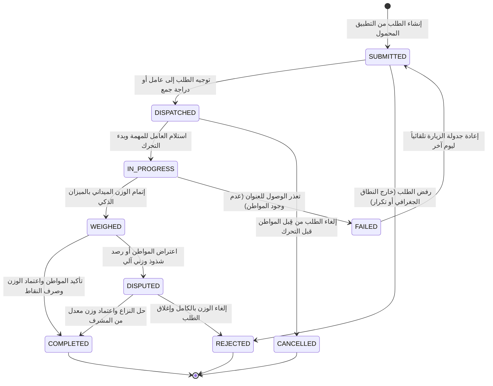
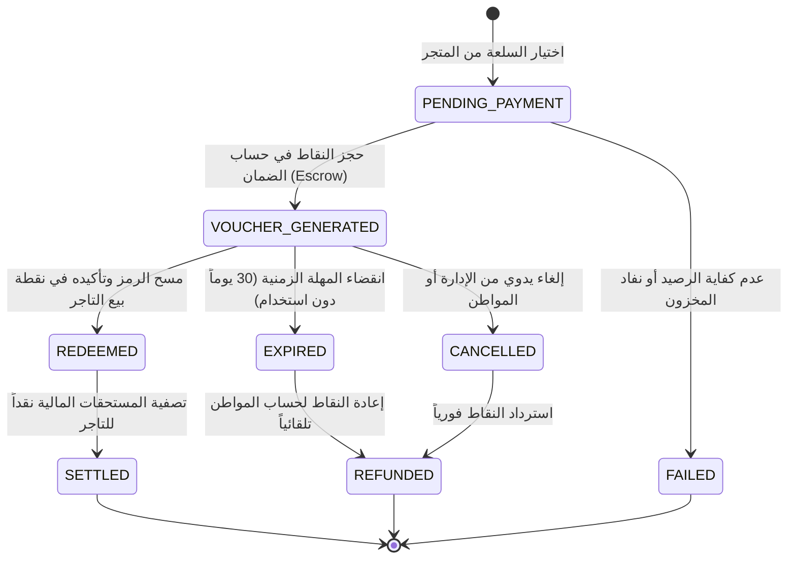
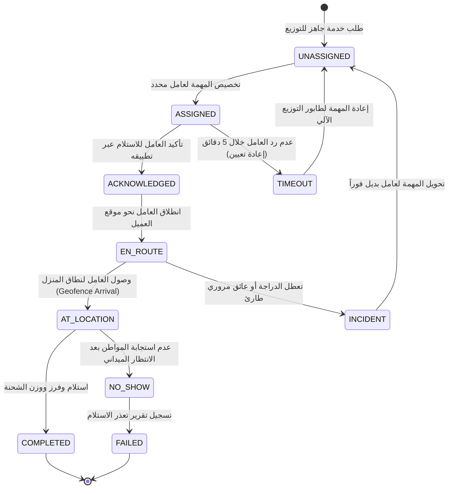
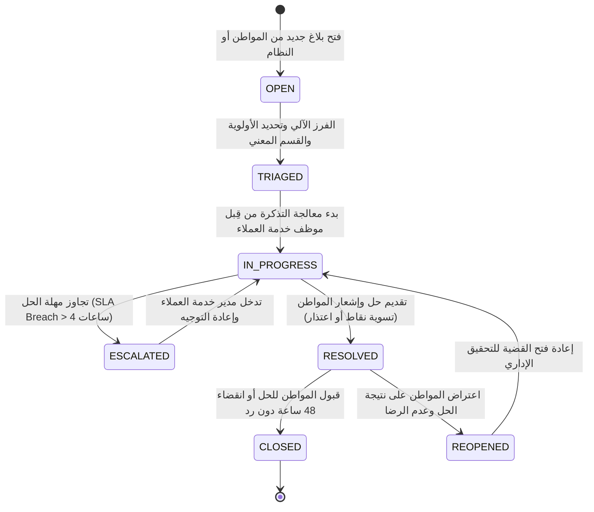

# آلات الحالة المحددة (Finite State Machines - FSM)
## منصة «أثر» — بلدية المنصورة (العقدة التشغيلية الأولى)

تعتمد منصة «أثر» على مفهوم **آلات الحالة المحددة (Finite State Machines)** لضبط انتقال دورات حياة الكيانات الحيوية الصارمة. لا يُسمح بأي انتقال عشوائي بين الحالات؛ بل يتم التحكم بكل انتقال عبر شروط مسبقة (Pre-conditions) وأحداث ناتجة (Side-effects) مسجلة في سجل الرقابة.

---

## 1. آلة حالة طلب خدمة استلام النفايات (`service_requests`)

تتحكم هذه الآلة في مسار جمع النفايات المنزلية من لحظة إنشاء الطلب في تطبيق المواطن وحتى الصرف النهائي للنقاط أو تسوية النزاعات.

### جدول مصفوفة الانتقالات لطلب الخدمة (State Transition Matrix):

| الحالة السابقة | الحدث المثير (Trigger) | الحالة التالية | الفاعل المصرح له | الشروط والآثار الجانبية |
| :--- | :--- | :--- | :--- | :--- |
| `SUBMITTED` | `DISPATCH_TASK` | `DISPATCHED` | النظام الآلي / المشرف | التحقق من وجود العامل في نفس النطاق `ST_Covers`. |
| `SUBMITTED` | `USER_CANCEL` | `CANCELLED` | المواطن | مسموح فقط خلال 15 دقيقة من رفع الطلب وقبل التوجيه. |
| `DISPATCHED` | `WORKER_ACCEPT` | `IN_PROGRESS` | عامل الميدان | تسجيل الطابع الزمني وتحديث خريطة التتبع المباشر. |
| `IN_PROGRESS` | `RECORD_WEIGH` | `WEIGHED` | عامل الميدان (عبر الميزان) | قراءة الميزان الرقمي عبر Bluetooth وفحص الشذوذ. |
| `WEIGHED` | `CONFIRM_RECEIPT` | `COMPLETED` | المواطن / المشرف | إصدار القيد المحاسبي في دفتر الأستاذ وإرسال إشعار الرصيد. |
| `WEIGHED` | `FLAG_ANOMALY` | `DISPUTED` | خوارزمية الذكاء / المواطن | تجميد إيداع النقاط حتى مراجعة موظف الرقابة بالبلدية. |

---

## 2. آلة حالة قسائم الشراء والمكافآت (`store_orders`)

تضمن هذه الآلة عدم تكرار صرف القسائم الرقمية في نقاط البيع وحماية حقوق الشركاء التجاريين في المنصورة.

### الشروط والضمانات المالية:
1. **قفل التنافس المتزامن (Concurrency Lock):** عند الشراء، يتم حجز عنصر المخزون عبر `FOR UPDATE` لتفادي بيع سلعة غير متوفرة لأكثر من مستخدم في نفس الجزء من الثانية.
2. **حساب الضمان الوسيط (Escrow Account):** لا تذهب النقاط مباشرة إلى التاجر بل تُحجز في `MERCHANT_ESCROW_ACCOUNT` حتى يتم المسح الفعلي للرمز أو تنتهي الصلاحية فيعاد الرصيد لصاحبه.

---

## 3. آلة حالة مهام التكليف الميداني (`worker_tasks`)

تتبع خطوات تحرك عمال النظافة وأسطول دراجات النقل في شوارع المنصورة لحظة بلحظة لضمان الالتزام بمواعيد الخدمة.

---

## 4. آلة حالة تذاكر الدعم والشكاوى الرقابية (`support_tickets`)

تطبيق اتفاقية مستوى الخدمة (SLA) الصارمة لحل اعتراضات المواطنين ومشاكل الأوزان والتأخيرات.

### معايير تصعيد الدعم الفني:
* **الأولوية القصوى (URGENT):** اعتراضات الأوزان التي تشير إلى شكوك احتيال أو سلوك غير مهني من العامل — مهلة الحل ساعتان فقط.
* **الأولوية العادية (MEDIUM):** استفسارات التطبيق أو تأخر الجمع العادي — مهلة الحل 12 ساعة كحد أقصى.
