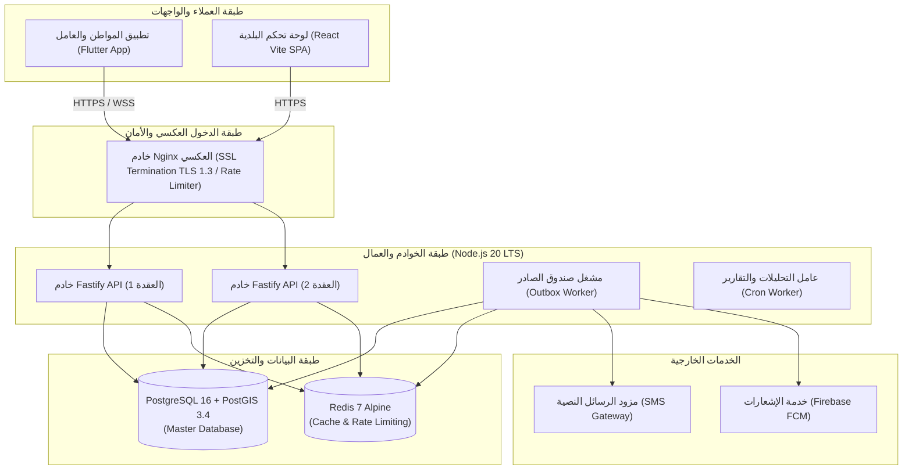

# النشر والعمليات والبنية التحتية (Deployment & DevOps)
## منصة «أثر» — بلدية المنصورة (العقدة التشغيلية الأولى)

توثق هذه الصفحة إعدادات التشغيل، وحاويات Docker، والبنية التحتية للخوادم، واستراتيجيات المراقبة وتسجيل الأحداث (Observability) لمنصة «أثر».

---

## 1. مخطط البنية التحتية للنشر والخدمات (Deployment Topology)



---

## 2. ملف بناء الحاوية متعدد المراحل (Multi-Stage Dockerfile)

ملف `Dockerfile` مخصص لإنتاج حاوية Node.js 20 Alpine خفيفة وعالية الأمان:

```dockerfile
# المرحلة 1: بناء الحزم وتجميع TypeScript
FROM node:20-alpine AS builder
WORKDIR /app

# تثبيت مدير الحزم pnpm
RUN corepack enable && corepack prepare pnpm@latest --activate

# نسخ ملفات الاعتماديات
COPY package.json pnpm-lock.yaml ./
RUN pnpm install --frozen-lockfile

# نسخ الكود المصدري وتجميعه
COPY tsconfig.json ./
COPY src ./src
RUN pnpm build

# استبعاد اعتماديات التطوير لتقليص الحجم
RUN pnpm prune --prod

# ----------------------------------------------------
# المرحلة 2: حاوية التشغيل الإنتاجية الخفيفة
FROM node:20-alpine AS runner
WORKDIR /app

ENV NODE_ENV=production
ENV PORT=3000

# تشغيل الحاوية بمستخدم غير جذري لتعزيز الأمان
USER node

# نسخ مخرجات البناء والاعتماديات الصافية فقط
COPY --chown=node:node --from=builder /app/package.json ./
COPY --chown=node:node --from=builder /app/node_modules ./node_modules
COPY --chown=node:node --from=builder /app/dist ./dist

EXPOSE 3000

# فحص صحة الحاوية التلقائي
HEALTHCHECK --interval=30s --timeout=5s --start-period=5s --retries=3 \
  CMD wget --no-verbose --tries=1 --spider http://localhost:3000/health/live || exit 1

CMD ["node", "dist/index.js"]
```

---

## 3. بيئة التشغيل المتكاملة (Docker Compose Setup)

ملف `docker-compose.yml` للتشغيل المحلي والإنتاجي الموحد:

```yaml
version: '3.9'

services:
  postgres:
    image: postgis/postgis:16-3.4-alpine
    container_name: athar_postgres
    restart: always
    environment:
      POSTGRES_USER: ${POSTGRES_USER:-athar_admin}
      POSTGRES_PASSWORD: ${POSTGRES_PASSWORD:-athar_secure_pass_2026}
      POSTGRES_DB: ${POSTGRES_DB:-athar_db}
    ports:
      - "5432:5432"
    volumes:
      - postgres_data:/var/lib/postgresql/data
    healthcheck:
      test: ["CMD-SHELL", "pg_isready -U ${POSTGRES_USER:-athar_admin} -d ${POSTGRES_DB:-athar_db}"]
      interval: 10s
      timeout: 5s
      retries: 5

  redis:
    image: redis:7-alpine
    container_name: athar_redis
    restart: always
    command: redis-server --requirepass ${REDIS_PASSWORD:-athar_redis_pass_2026} --appendonly yes
    ports:
      - "6379:6379"
    volumes:
      - redis_data:/data
    healthcheck:
      test: ["CMD", "redis-cli", "-a", "${REDIS_PASSWORD:-athar_redis_pass_2026}", "ping"]
      interval: 10s
      timeout: 5s
      retries: 5

  api:
    build:
      context: .
      dockerfile: Dockerfile
    container_name: athar_api
    restart: always
    depends_on:
      postgres:
        condition: service_healthy
      redis:
        condition: service_healthy
    environment:
      - NODE_ENV=production
      - PORT=3000
      - DATABASE_URL=postgresql://${POSTGRES_USER:-athar_admin}:${POSTGRES_PASSWORD:-athar_secure_pass_2026}@postgres:5432/${POSTGRES_DB:-athar_db}?schema=public
      - REDIS_URL=redis://:${REDIS_PASSWORD:-athar_redis_pass_2026}@redis:6379/0
      - JWT_SECRET=${JWT_SECRET}
      - DATA_ENCRYPTION_KEY=${DATA_ENCRYPTION_KEY}
      - BLIND_INDEX_PEPPER=${BLIND_INDEX_PEPPER}
    ports:
      - "3000:3000"

  outbox_worker:
    build:
      context: .
      dockerfile: Dockerfile
    container_name: athar_outbox_worker
    restart: always
    command: ["node", "dist/workers/outbox-dispatcher.js"]
    depends_on:
      postgres:
        condition: service_healthy
      redis:
        condition: service_healthy
    environment:
      - NODE_ENV=production
      - DATABASE_URL=postgresql://${POSTGRES_USER:-athar_admin}:${POSTGRES_PASSWORD:-athar_secure_pass_2026}@postgres:5432/${POSTGRES_DB:-athar_db}?schema=public
      - REDIS_URL=redis://:${REDIS_PASSWORD:-athar_redis_pass_2026}@redis:6379/0
      - SMS_GATEWAY_API_KEY=${SMS_GATEWAY_API_KEY}

volumes:
  postgres_data:
  redis_data:
```

---

## 4. مصفوفة متغيرات البيئة السرية (Environment Variables Matrix)

| المتغير | النوع | الإلزامية | الوصف |
| :--- | :--- | :--- | :--- |
| `NODE_ENV` | String | نعم | `development` أو `production` |
| `DATABASE_URL` | String | نعم | رابط الاتصال بقاعدة PostgreSQL مع بيانات الاعتماد |
| `REDIS_URL` | String | نعم | رابط الاتصال بخادم Redis |
| `JWT_SECRET` | String | نعم | مفتاح توقيع رموز المصادقة (64 حرفاً عشوائياً) |
| `DATA_ENCRYPTION_KEY`| Hex (64) | نعم | مفتاح تشفير البيانات الحساسة AES-256-GCM |
| `BLIND_INDEX_PEPPER` | Hex (64) | نعم | بهار التجزئة المستخدم للفهرسة العمياء برقم الهاتف |
| `SMS_GATEWAY_API_KEY`| String | نعم | مفتاح الربط مع مزود الرسائل النصية القصيرة |

---

## 5. مراقبة الأداء ونقاط فحص الصحة (Observability & Health Checks)

### 5.1 نقاط فحص الصحة (Health Endpoints):
* **`GET /health/live` (Liveness Probe):**
  يعيد `200 OK` فور استجابة حلقة الأحداث (Event Loop) للتأكد من أن السيرفر غير متجمد.
* **`GET /health/ready` (Readiness Probe):**
  يفحص الاتصال الفعلي بقاعدة بيانات PostgreSQL وخادم Redis قبل استقبال أي زيارات من موازن الأحمال:
  ```json
  {
    "status": "UP",
    "timestamp": "2026-10-11T04:47:30Z",
    "checks": {
      "database": "UP (12ms)",
      "redis": "UP (2ms)",
      "outboxQueueLag": 0
    }
  }
  ```

### 5.2 التسجيل الهيكلي عبر مكتبة Pino (Structured JSON Logging):
تُخرج جميع الطلبات والأخطاء بصيغة JSON عالية السرعة متضمنةً `requestId` و `durationMs` و `userId` مما يتيح تصديرها مباشرة إلى Grafana Loki أو ElasticSearch.
