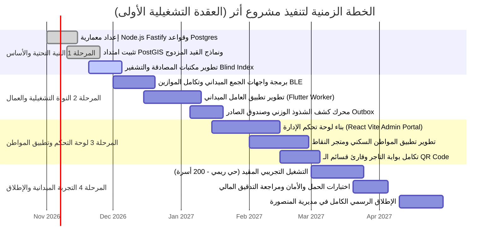
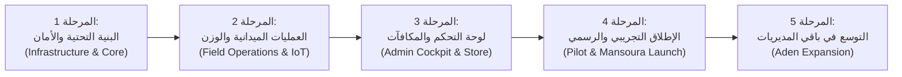

# خارطة طريق المشروع ومراحل الإطلاق (Project Roadmap & Milestones)
## منصة «أثر» — بلدية المنصورة (العقدة التشغيلية الأولى)

تحدد هذه الوثيقة المراحل الزمنية التفصيلية لتنفيذ، اختبار، ونشر منصة «أثر» في مديرية المنصورة (عدن) وصولاً للتشغيل الكامل والتوسع اللاحق.

---

## 1. مخطط جانت الزمني (Gantt Chart)

---

## 2. المسار التتابعي للمراحل (Milestone Pipeline Flowchart)

---

## 3. تفاصيل المراحل ومخرجات التسليم (Phase Deliverables)

### المرحلة 1: التأسيس والبنية التحتية والأمان (نوفمبر 2026)
* **المخرجات:**
  * تهيئة مستودع الكود المنظم (Modular Monolith) بلغة TypeScript و Fastify.
  * إعداد قاعدة بيانات PostgreSQL 16 مع PostGIS 3.4 وهيكلة الجداول الـ 28.
  * تفعيل تشفير البيانات الحساسة AES-256-GCM والفهرسة العمياء برقم الهاتف.
  * إعداد خط أنابيب CI/CD وحاويات Docker للبيئة التطويرية.

### المرحلة 2: العمليات الميدانية وتكامل إنترنت الأشياء (ديسمبر 2026 – يناير 2027)
* **المخرجات:**
  * بناء محرك التوجيه الجغرافي وحساب المسافات بنظام PostGIS `ST_Covers`.
  * إنجاز تطبيق عمال النظافة (Flutter) مع دعم المزامنة أثناء انقطاع الشبكة (Offline-First).
  * ربط الميزان الذكي عبر بروتوكول Bluetooth Low Energy (BLE) لقراءة الوزن لحظياً.
  * تنفيذ خوارزمية كشف الشذوذ الوزني وصندوق الصادر الموثوق (Transactional Outbox).

### المرحلة 3: لوحة التحكم وتطبيق المواطن ومتجر الشركاء (يناير – فبراير 2027)
* **المخرجات:**
  * تدشين لوحة تحكم إدارة البلدية (Desktop Web SPA) بغرف العمليات الست (التوجيه، التذاكر، المتجر، المالية، النطاقات، الرقابة).
  * إطلاق تطبيق المواطن السكني لرفع طلبات الجمع ومتابعة الرصيد واستبدال المكافآت.
  * بناء بوابة نقاط البيع للشركاء التجاريين في المنصورة لاعتماد القسائم عبر الـ QR Code.
  * تفعيل القيد المزدوج المتوازن لحسابات النقاط الخضراء.

### المرحلة 4: الإطلاق التجريبي المقيد والمراجعة الأمنية (مارس – أبريل 2027)
* **المخرجات:**
  * إطلاق تجريبي (Closed Pilot) في حي ريمي السكني لعدد 200 أسرة و 4 دراجات جمع.
  * قياس معدل استجابة النظام وأوقات الاستلام ودقة الموازين الرقمية.
  * إجراء اختبارات الاختراق الشاملة وفحص الثغرات (Penetration Testing).
  * التدقيق المالي على دفتر الأستاذ والتأكد من تطابق أرصدة النقاط مع الميزان المحاسبي.

### المرحلة 5: الإطلاق الرسمي والتوسع الجغرافي (مايو 2027 فصاعداً)
* **المخرجات:**
  * الإطلاق الرسمي وتغطية كافة المربعات السكنية لمديرية المنصورة (العقدة 1).
  * التجهيز لربط مديريات الشيخ عثمان، المعلا، وصيرة كعقد تشغيلية لاحقة (Nodes 2, 3, 4).
